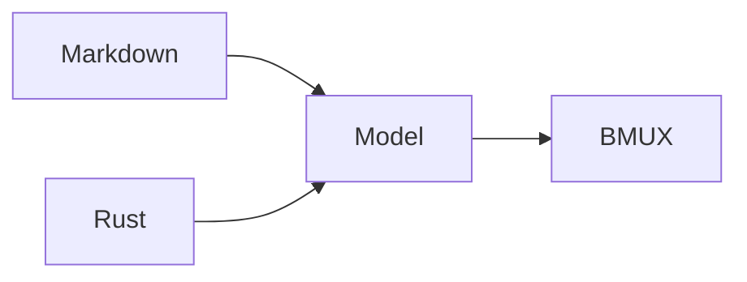

<!-- bmux:slide-id intro -->

# BMUX presentations

Markdown authoring and linked Rust applications share one portable model.

<!-- bmux:pause -->

Reveals are cumulative. Hidden content reserves geometry by default.

<!-- bmux:notes -->

These notes are private and are not rendered in the audience viewer.

<!-- bmux:end-notes -->

---

<!-- bmux:slide-id content -->
<!-- bmux:columns 1,1 -->

## Code

```rust
let state = PresentationState::new(&deck);
```

<!-- bmux:column -->

| Feature | Owner |
| --- | --- |
| Layout | BMUX |
| State | Application |

<!-- bmux:end-columns -->

---

<!-- bmux:slide-id rich -->




<!-- bmux:pause -->
<!-- bmux:component demo-button {} -->
