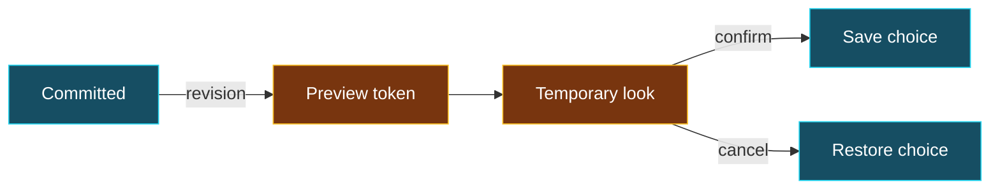
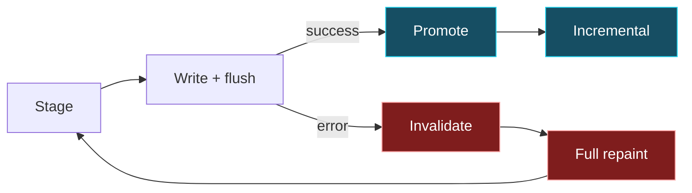

<!-- markdownlint-disable MD025 -->
<!-- Slide decks intentionally have one top-level heading per slide. -->
<!-- bmux:slide-id vocabulary -->
<!-- bmux:block-id vocabulary-title -->
# Which thing owns which state?

<!-- bmux:block-id vocabulary-map -->
| Concept | Responsibility |
| --- | --- |
| Runtime / session / pane | Execution environment, lifetime, terminal surface |
| Tab / workspace | Plugin-owned attach unit and organization |
| Arrangement | Personal references or deliberately shared organization |
| Client / attachment | Viewer association, local selection and interaction |

<!-- bmux:notes -->
Quick path: Use docs/concepts.md and INVARIANTS.md as vocabulary/ownership authorities. These are conceptual responsibilities, not a new data schema.
Deeper path: A personal reference is not ownership of the underlying process. Removal must preserve discoverability of authorized running work and resolve or suspend an invalid selected input target. A shared edit remains shared; local focus independence is a different claim. Process survival across machine restart is not promised.
<!-- bmux:end-notes -->

---
<!-- bmux:slide-id plugin-contracts -->
<!-- bmux:block-id plugin-contracts-title -->
# Stable contract ≠ runtime implementation

<!-- bmux:block-id plugin-contracts-flow -->
BPDL schema → generated services, clients, events, and capabilities.

<!-- bmux:block-id plugin-contracts-ownership -->
API crates carry stable models and generated transport. Implementations own state, lifecycle, policy, and orchestration. Neutral host primitives do not acquire plugin-domain convenience APIs.

<!-- bmux:notes -->
Quick path: Refer back to tabs-commands and theme-control-v1 in the main deck. Those are exact schema excerpts, not runtime managers.
Deeper path: AGENTS.md requires domain-neutral core and stable plugin API crates. HostRuntimeApi is limited to core_cli_command_run_path, plugin_command_run, storage_get, storage_set, log_write, and recording_write_event. Foundational plugins may call kernel requests; other plugins use their typed services. Do not claim all historical migrations are complete merely because this is the required boundary.
<!-- bmux:end-notes -->

---
<!-- bmux:slide-id image-lifecycle -->
<!-- bmux:block-id image-lifecycle-title -->
# Image resources and raster footprints differ

<!-- bmux:block-id image-lifecycle-table -->
| Host protocol | BMUX strategy | Cleanup distinction |
| --- | --- | --- |
| Kitty | Retain upload; place again | Placement versus content lifetime |
| Sixel / iTerm2 | Cache encoding; emit raster again | Raster footprint repair and repaint |

<!-- bmux:block-id image-lifecycle-contract -->
A failed write or flush makes host state uncertain. Repair assumptions before incremental reuse.

<!-- bmux:notes -->
Quick path: Point to render_attach_frame_inner's pending_kitty_state and failure invalidation, then its successful cache promotion. These are strategy summaries, not full protocol specifications.
Deeper path: The code distinguishes raster_image_protocol footprints from persistent Kitty placements; its comment warns that ED2 can destroy cached Kitty uploads. See docs/images.md and docs/image-performance.md for protocol/performance context. A microbenchmark does not establish correctness on the audience terminal.
Rehearsal gate: confirm supported protocol, exact terminal, resize behavior, and visible cleanup. The tour's rendering script demonstrates text updates, not image protocol acceptance.
<!-- bmux:end-notes -->

---
<!-- bmux:slide-id reusable-ui -->
<!-- bmux:block-id reusable-ui-title -->
# Reuse without reversing dependencies

<!-- bmux:block-id reusable-ui-layers -->
Primitives: geometry, painting, buffers, input, damage.

<!-- bmux:block-id reusable-ui-components -->
Components: reusable controls built on primitives.

<!-- bmux:block-id reusable-ui-runtime -->
Runtime: scheduling and lifecycle built on primitives—not components.

<!-- bmux:block-id reusable-ui-product -->
Applications/plugins: product-specific state and behavior.

<!-- bmux:notes -->
Quick path: This is a dependency/ownership explanation, not a claim that every layer calls the next in a single stack. Source: docs/tui-framework.md and INVARIANTS.md.
Deeper path: Composition still converges on one retained authority. A browser or observer is another transport/consumer, not permission to create competing hit-test, focus, revision, or lifecycle semantics. Embedded rasters explicitly lack some producer logical metadata; do not infer text selection/copy from visible cells.
<!-- bmux:end-notes -->

---
<!-- bmux:slide-id evidence -->
<!-- bmux:block-id evidence-followup-title -->
# Three levels of confidence

<!-- bmux:block-id evidence-levels -->
1. **Contract:** what the system must preserve.
2. **Implementation:** the exact branch or schema we inspected.
3. **Executed evidence:** what this artifact and scenario actually established.

<!-- bmux:block-id evidence-limits -->
Do not promote an unrun demo, a passing screenshot, or a fixture label into a stronger claim.

<!-- bmux:notes -->
Quick path: Return to the sources checklist. Historical six-demo acceptance is not current approval of edited scripts. Validate the settled artifact, then separately rehearse audience/privacy and browser/Canvas delivery.
Deeper path: Unit/protocol/pixel assertions, PTY integration, injected failures, and actual terminal/browser rehearsal answer different questions. Benchmark work counts answer another. Retained final output is not an execution-output journal and is not proof all intermediate frames were observed. Redact private artifacts and capability-bearing URLs before sharing.
<!-- bmux:end-notes -->

---
<!-- bmux:slide-id technical-depth-route -->
<!-- bmux:block-id technical-depth-route-title -->
# Optional depth: follow the question, not every interface

Return here for typed split operations, discovery contracts, theme preview concurrency, or managed-demo admission.

These slides are supporting material—not prerequisites for the main story.

---
<!-- bmux:slide-id splits-contract -->
<!-- bmux:block-id splits-contract-title -->
# A split is an operation, not a key binding

<!-- bmux:block-id excerpt-split -->
```text
    command split-pane(
        session: selector?,
        target: selector?,
        direction: pane-direction,
        ratio-pct: u32?,
    ) -> result<pane-ack, pane-mutation-error>;
```

<!-- bmux:block-id split-provenance -->
`plugins/tabs-plugin-api/bpdl/tabs-plugin.bpdl` · `tabs-commands.split-pane`

<!-- bmux:block-id split-architecture -->
Input specifies a target, direction, and optional ratio. Success returns `pane-ack`; failure returns a typed `pane-mutation-error`. The shortcut does not define this contract.

<!-- bmux:notes -->
Quick path: Point out target, direction, and typed failure. A keyboard shortcut is one entry point, not the definition of splitting.
Deeper path: This is exact BPDL, not Rust or pseudocode. The same interface also exposes resize-pane and zoom-pane; this excerpt does not prove a particular keymap. API crates own contracts; runtime orchestration belongs in plugin implementations. Foundational plugins may invoke kernel requests; core must not grow tabs convenience APIs.
This schema names the operation; the next slide shows the plugin policy that implements it. Rendering later consumes retained presentation state rather than calling plugins to reconstruct a frame.
Transition: “What policy sits between that command and the actual split?”
<!-- bmux:end-notes -->

---
<!-- bmux:slide-id ownership-contract -->
<!-- bmux:block-id ownership-contract-title -->
# Discovery and placement have different jobs

<!-- bmux:block-id excerpt-catalog -->
```text
interface tabs-catalog-v1 {
    // Complete discovery in workspace order, then each workspace's tab arrangement.
    // Reading this catalog never initializes or rewrites arrangement storage.
    query list-tabs() -> result<list<tabs-state.tab-entry>, string>;
}
```

<!-- bmux:block-id catalog-provenance -->
`plugins/tabs-plugin-api/bpdl/tabs-plugin.bpdl` · `tabs-catalog-v1`

<!-- bmux:block-id ownership-boundary -->
Ask which tabs exist without changing their arrangement. The finder uses this catalog; moving a tab is a separate operation.

<!-- bmux:notes -->
Quick path: Read the “never initializes or rewrites” line. A finder can ask what exists without acquiring ownership of its arrangement.
Deeper path: The neighboring tabs-placement-v1 contract says placement appends to the destination before changing the workspace attribute, retains source references, and is retry-idempotent. Those are ownership semantics, not just labels in a tab bar. Consult INVARIANTS.md for authority, discoverability, and input-safety contracts; do not describe the schema as proof of all recovery cases.
Keep the boundary honest: neutral host mechanisms are not a second source of domain policy. Missing optional domains must not turn baseline server primitives into domain-specific core behavior.
Transition: “That separation makes a workspace-wide finder possible.”
<!-- bmux:end-notes -->

---
<!-- bmux:slide-id preview-lifecycle -->
<!-- bmux:block-id preview-lifecycle-title -->
# Preview is temporary authority, not a saved choice

<!-- bmux:block-id preview-lifecycle-diagram -->


<!-- bmux:block-id preview-lifecycle-takeaway -->
**Revision checks protect entry; the token owns the preview.** This is the control-service contract; the live picker uses a separate interactive prompt path.

<!-- bmux:notes -->
Question: Why not save on every Down key? A preview must be reversible and owned. Cyan is committed state; amber is temporary authority/appearance. Moving among candidates changes live appearance without treating each highlight as a saved selection. That repeated preview step is compressed into Temporary look; Save choice and Restore choice are outcomes, not additional state owners. Confirm and cancel are distinct operations.
Source: plugins/theme-plugin/bpdl/theme-plugin.bpdl, theme-control-v1. This is a successful-path lifecycle, not a complete error state machine. Begin can reject a stale expected revision; token operations can fail and are not unconditional transitions. Renew-preview and cleanup/expiry handling are intentionally omitted. The demo shows previews and confirmation, not all races or cancellation cases.
<!-- bmux:end-notes -->

---
<!-- bmux:slide-id themes-control -->
<!-- bmux:block-id themes-control-title -->
# Stale controls must not silently win

<!-- bmux:block-id excerpt-theme-control -->
```text
    command current() -> snapshot;
    command select(expected-revision: u64, selection: selection) -> result<snapshot, string>;
    command refresh(expected-revision: u64) -> result<snapshot, string>;
    command begin-preview(expected-revision: u64) -> result<u64, string>;
    command preview(token: u64, selection: selection) -> result<unit, string>;
    command cancel-preview(token: u64) -> result<unit, string>;
    command confirm-preview(token: u64, selection: selection) -> result<snapshot, string>;
```

<!-- bmux:block-id theme-control-provenance -->
`plugins/theme-plugin/bpdl/theme-plugin.bpdl` · `theme-control-v1` · excerpt

<!-- bmux:block-id theme-control-scope -->
Service operations, not the picker's literal call stack. Interactive prompt handlers acquire and renew preview ownership separately; both reach the theme owner's state.

<!-- bmux:notes -->
Quick path: Read revision before mutation; carry the expected revision back. Preview uses an owned token rather than pretending every temporary frame is committed selection.
Deeper path: The schema's snapshot pairs revision with selection. The contract also exposes renew-preview, external forms, and component settings; the excerpt intentionally omits those. Runtime state and lifecycle belong in the implementation, not the stable API contract. See ThemePlugin::begin_preview, confirm_preview, and select_without_preview for implementation follow-up.
Rehearsal gate: an accepted appearance demo is not evidence of conflict handling unless it actually exercises conflicting revisions. No claim that source inspection replaces that test.
Transition: “Revisions also matter at the output boundary: prepared is not yet presented.”
<!-- bmux:end-notes -->

---
<!-- bmux:slide-id frame-transaction -->
<!-- bmux:block-id frame-transaction-title -->
# Only successful output advances the local baseline

<!-- bmux:block-id frame-transaction-diagram -->


<!-- bmux:block-id frame-transaction-takeaway -->
**A failed flush leaves host output uncertain.** Do not promote pending cursor/graphics state or trust the old row baseline.

<!-- bmux:notes -->
Question: Why can a screenshot look right while the renderer is wrong? Incremental work depends on a known delivered baseline, not just a successfully constructed buffer. Cyan is promotion; red is repair. A partial write is not reversible: invalidation and full repaint repair assumptions, not an atomic rollback of terminal pixels.
Sources: packages/attach_pipeline/src/terminal.rs write_frame; packages/cli/src/runtime/attach/runtime.rs render_attach_frame_inner write_result branch and following cache promotion. Successfully written/flushed frames enter display capture. This diagram is terminal delivery, not a claim that a browser has already painted a received frame. The demo does not inject output failures.
<!-- bmux:end-notes -->

---
<!-- bmux:slide-id demo-authority -->
<!-- bmux:block-id demo-authority-title -->
# One input authority; many read-only views

<!-- bmux:block-id demo-authority-diagram -->


<!-- bmux:block-id demo-authority-takeaway -->
**The audience sees the execution owner's view.** It does not get a second attach, shell input, or authority to start work.

<!-- bmux:notes -->
Question: Is the embedded demo a real UI, a recording, or another controller? The worker drives the actual owned attach. The presenter reads a bounded latest complete repair, validates lifetime identity/revision, and paints retained output; it does not reconstruct the scene from pane text. Cyan is execution/input authority; violet is the read-only projection. Arrows show the data path, not extra processes: browser output is optional.
Sources: plugins/presenter-plugin/src/playbook.rs admission; packages/playbook/src/managed_display.rs DisplayPacket; plugins/presenter-plugin/src/playbook_capture.rs ManagedCaptureCursor; playbook_observer.rs. Generation/epoch/revision fencing are simplified here. A missing repair is not completion. Stop requests, cleanup acknowledgment, and restart are separate lifecycle facts; output retention is bounded, not a complete output history.
<!-- bmux:end-notes -->

---
<!-- bmux:slide-id playbooks-boundary -->
<!-- bmux:block-id playbooks-boundary-title -->
# Run only explicitly approved demos

<!-- bmux:block-id excerpt-managed-admission -->
```rust
        if !matches!(
            deck.config.driver,
            bmux_playbook::types::PlaybookDriver::Sandbox
        ) || deck.config.sandbox_config_file.is_some()
        {
            return Err(
                "managed execution requires sandbox driver and generated isolated configuration"
                    .into(),
            );
        }
```

<!-- bmux:block-id managed-provenance -->
`plugins/playbook-plugin/src/runner.rs` · `Owner::prepare`

<!-- bmux:block-id managed-safety -->
Opt in with `--allow-playbooks`, then manually start. This guard rejects real-attach and custom configuration; the owner supplies isolated paths and cleanup. Approved shell actions are trusted code—not security-sandboxed.

<!-- bmux:notes -->
Quick path: This rejects real-attach and custom sandbox-config. It is why an ordinary fixture cannot automatically become an embedded demo.
Deeper path: Owner::prepare also rejects BMUX_/XDG_ runtime-selector environment overrides. Sources/includes are frozen and closure-checked; changed executable bytes require fresh approval. Generation-fenced lifecycle control and retained output are distinct from arbitrary terminal input. A stop request is not cleanup acknowledgment; Escape only hides the overlay.
Rehearsal: select an approved immutable native executable; protocol compatibility does not establish executable content identity. Do not describe isolation as protection from untrusted shell commands. Finder/themes use the supported managed attach authority without weakening admission.
Transition: “The same separation—content versus execution—also makes the presentation reusable.”
<!-- bmux:end-notes -->
