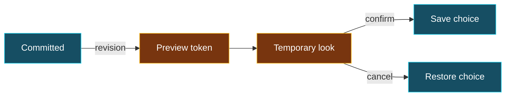

<!-- markdownlint-disable MD025 -->
<!-- Slide decks intentionally have one top-level heading per slide. -->
<!-- bmux:slide-id vocabulary -->
<!-- bmux:block-id vocabulary-title -->
# Which thing owns which state?

<!-- bmux:block-id vocabulary-map -->
| Concept | Responsibility |
| --- | --- |
| Runtime / session / pane | Execution environment, lifetime, terminal surface |
| Tab / workspace | Plugin-owned attach unit and organization |
| Arrangement | Personal references or deliberately shared organization |
| Client / attachment | Viewer association, local selection and interaction |

<!-- bmux:notes -->
Optional depth. Point to the contract and its owning layer.
<!-- bmux:end-notes -->

---
<!-- bmux:slide-id plugin-contracts -->
<!-- bmux:block-id plugin-contracts-title -->
# Stable contract ≠ runtime implementation

<!-- bmux:block-id plugin-contracts-flow -->
BPDL schema → generated services, clients, events, and capabilities.

<!-- bmux:block-id plugin-contracts-ownership -->
API crates carry stable models and generated transport. Implementations own state, lifecycle, policy, and orchestration. Neutral host primitives do not acquire plugin-domain convenience APIs.

<!-- bmux:notes -->
Optional depth. Point to the contract and its owning layer.
<!-- bmux:end-notes -->

---
<!-- bmux:slide-id reusable-ui -->
<!-- bmux:block-id reusable-ui-title -->
# Reuse without reversing dependencies

<!-- bmux:block-id reusable-ui-layers -->
Primitives: geometry, painting, buffers, input, damage.

<!-- bmux:block-id reusable-ui-components -->
Components: reusable controls built on primitives.

<!-- bmux:block-id reusable-ui-runtime -->
Runtime: scheduling and lifecycle built on primitives—not components.

<!-- bmux:block-id reusable-ui-product -->
Applications/plugins: product-specific state and behavior.

<!-- bmux:notes -->
Optional depth. Point to the contract and its owning layer.
<!-- bmux:end-notes -->

---
<!-- bmux:slide-id evidence -->
<!-- bmux:block-id evidence-followup-title -->
# Three levels of confidence

<!-- bmux:block-id evidence-levels -->
1. **Contract:** what the system must preserve.
2. **Implementation:** the exact branch or schema we inspected.
3. **Executed evidence:** what this artifact and scenario actually established.

<!-- bmux:block-id evidence-limits -->
Do not promote an unrun demo, a passing screenshot, or a fixture label into a stronger claim.

<!-- bmux:notes -->
Optional depth. Point to the contract and its owning layer.
<!-- bmux:end-notes -->

---
<!-- bmux:slide-id technical-depth-route -->
<!-- bmux:block-id technical-depth-route-title -->
# Optional depth: follow the question, not every interface

Return here for typed split operations, discovery contracts, theme preview concurrency, or managed-demo admission.

These slides are supporting material—not prerequisites for the main story.

<!-- bmux:notes -->
Optional depth. Point to the contract and its owning layer.
<!-- bmux:end-notes -->
---
<!-- bmux:slide-id splits-contract -->
<!-- bmux:block-id splits-contract-title -->
# A split is an operation, not a key binding

<!-- bmux:block-id excerpt-split -->
```text
    command split-pane(
        session: selector?,
        target: selector?,
        direction: pane-direction,
        ratio-pct: u32?,
    ) -> result<pane-ack, pane-mutation-error>;
```

<!-- bmux:block-id split-provenance -->
`plugins/tabs-plugin-api/bpdl/tabs-plugin.bpdl` · `tabs-commands.split-pane`

<!-- bmux:block-id split-architecture -->
Input specifies a target, direction, and optional ratio. Success returns `pane-ack`; failure returns a typed `pane-mutation-error`. The shortcut does not define this contract.

<!-- bmux:notes -->
Optional depth. Point to the contract and its owning layer.
<!-- bmux:end-notes -->

---
<!-- bmux:slide-id ownership-contract -->
<!-- bmux:block-id ownership-contract-title -->
# Discovery and placement have different jobs

<!-- bmux:block-id excerpt-catalog -->
```text
interface tabs-catalog-v1 {
    // Complete discovery in workspace order, then each workspace's tab arrangement.
    // Reading this catalog never initializes or rewrites arrangement storage.
    query list-tabs() -> result<list<tabs-state.tab-entry>, string>;
}
```

<!-- bmux:block-id catalog-provenance -->
`plugins/tabs-plugin-api/bpdl/tabs-plugin.bpdl` · `tabs-catalog-v1`

<!-- bmux:block-id ownership-boundary -->
Ask which tabs exist without changing their arrangement. The finder uses this catalog; moving a tab is a separate operation.

<!-- bmux:notes -->
Optional depth. Point to the contract and its owning layer.
<!-- bmux:end-notes -->

---
<!-- bmux:slide-id preview-lifecycle -->
<!-- bmux:block-id preview-lifecycle-title -->
# Preview is temporary authority, not a saved choice

<!-- bmux:block-id preview-lifecycle-diagram -->


<!-- bmux:block-id preview-lifecycle-takeaway -->
**Revision checks protect entry; the token owns the preview.** This is the control-service contract; the live picker uses a separate interactive prompt path.

<!-- bmux:notes -->
Optional depth. Point to the contract and its owning layer.
<!-- bmux:end-notes -->

---
<!-- bmux:slide-id themes-control -->
<!-- bmux:block-id themes-control-title -->
# Stale controls must not silently win

<!-- bmux:block-id excerpt-theme-control -->
```text
    command current() -> snapshot;
    command select(expected-revision: u64, selection: selection) -> result<snapshot, string>;
    command refresh(expected-revision: u64) -> result<snapshot, string>;
    command begin-preview(expected-revision: u64) -> result<u64, string>;
    command preview(token: u64, selection: selection) -> result<unit, string>;
    command cancel-preview(token: u64) -> result<unit, string>;
    command confirm-preview(token: u64, selection: selection) -> result<snapshot, string>;
```

<!-- bmux:block-id theme-control-provenance -->
`plugins/theme-plugin/bpdl/theme-plugin.bpdl` · `theme-control-v1` · excerpt

<!-- bmux:block-id theme-control-scope -->
Service operations, not the picker's literal call stack. Interactive prompt handlers acquire and renew preview ownership separately; both reach the theme owner's state.

<!-- bmux:notes -->
Optional depth. Point to the contract and its owning layer.
<!-- bmux:end-notes -->
