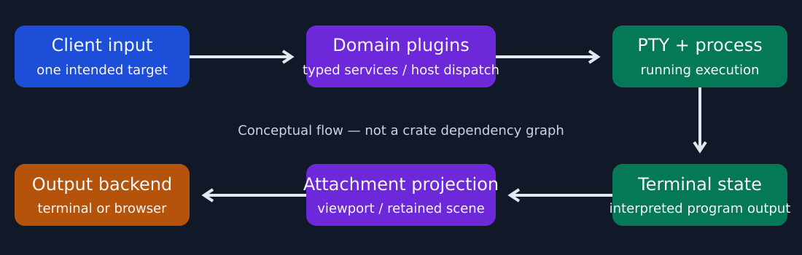
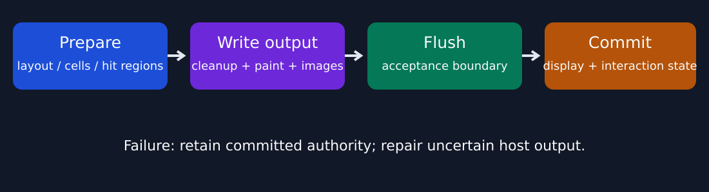
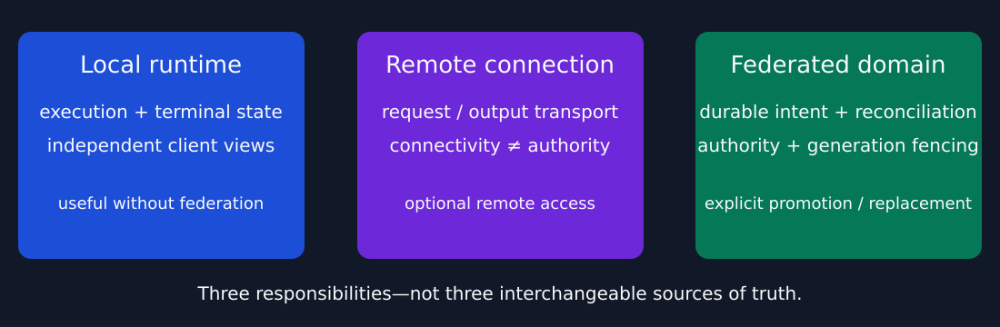

<!-- bmux:slide-id opening -->
# BMUX

## Building a terminal workspace from the ground up

A Rust terminal multiplexer + reusable terminal UI framework.

**Execution, extensibility, and presentation—with explicit boundaries.**

<!-- bmux:notes -->
00:00–00:45. Open with BMUX already running, not a terminal full of build output.
“BMUX is a terminal multiplexer, but building it also led to reusable UI infrastructure. I’ll show what it does, then follow a few paths through the implementation.”
Add one sentence about your real motivation during rehearsal; this deck intentionally does not invent one.
The theme of the talk is separating running work from how people view and interact with it.
Transition: “First, here’s the user-facing result.”
<!-- bmux:end-notes -->

---
<!-- bmux:slide-id workspace -->
# Running work ≠ a client’s view

- Panes execute terminal programs.
- Tabs organize attachable work; workspaces group tabs.
- Clients keep their own selection, focus, and navigation.

**Demo 1 · one running session, two views · 75 seconds**

Changing a view is not restarting the program.

<!-- bmux:notes -->
00:45–02:30. Show a prepared split, switch a workspace/tab, then show two attachments to the same work with independent focus/selection. Do not change a shared arrangement and call that independence: shared durable edits are deliberately shared.
“Server-backed execution survives a client disconnect. That is different from saying an arbitrary process survives machine restart.”
Demo ends when the same marker is visible in both attachments. If the demo stalls, explain the intended relationship and move on within 15 seconds.
Transition: “What has to happen between pressing a key and seeing its output?”
<!-- bmux:end-notes -->

---
<!-- bmux:slide-id system -->
# Follow a keystroke—and its output



**Authoritative terminal state → per-attachment projection → output.**

<!-- bmux:notes -->
02:30–04:15. Read the top row left to right, then the bottom row right to left.
“Input is routed to one intended execution, rather than broadcast to every component. Plugins own domain behavior; the host supplies generic dispatch and execution mechanisms. A PTY carries the program’s bytes, and a terminal grid interprets them. Each attachment projects the relevant view before rendering.”
This is a conceptual path, not a literal crate dependency graph or a promise that every event visits every box. Do not describe all terminal behavior as pass-through ANSI.
Transition: “That middle box is intentionally extensible.”
<!-- bmux:end-notes -->

---
<!-- bmux:slide-id plugins -->
# Plugins own product behavior

**Generic host:** execution · transport · storage · dispatch

**Plugin domains:** tabs · workspaces · contexts · permissions

```text
@capability(TABS_WRITE)
interface tabs-placement-v1 {
    command place-tab(context-id: uuid,
                      workspace-id: uuid)
        -> result<unit, string>;
}
```

Typed contracts—not private cross-plugin runtime state.

<!-- bmux:notes -->
04:15–05:45. The snippet is from the actual tabs BPDL schema, reformatted for the slide.
“The domain owns the policy and the stable contract. Consumers call typed generated services rather than importing a manager implementation. UI plugins publish revisioned surfaces through generic layout and rendering interfaces.”
Tabs, sessions, clients, panes, and federation are product domains even where foundational facades reach generic kernel mechanisms. Don’t claim the current repository has eliminated every legacy boundary violation.
Skip schema syntax details unless asked. Transition: “The same separation applies to UI state and pixels.”
<!-- bmux:end-notes -->

---
<!-- bmux:slide-id rendering -->
# A frame is a transaction



Cells, image placement, hit regions, and focus must agree.

**Case study:** an image upload cache survived a screen erase.
The cache said “present”; the terminal said “gone.”

<!-- bmux:notes -->
05:45–08:00. Explain layout and clipping once, then use the recent image failure as a concrete lesson.
“An optimization retained uploaded Kitty content. A later generic screen erase invalidated what the host could show, while our cache still treated the upload as reusable. Graphics-only tests missed that interaction with ordinary terminal output.”
“We separated persistent Kitty placement handling from raster repair, and added redraw/navigation regressions. Sixel and iTerm2 need cleanup before complete cell repainting, rather than blindly sharing Kitty’s lifecycle.”
A successful write is not enough: flush must succeed before committing interaction metadata. Failed output requires repair. This is a correctness story, not a claim of complete compatibility with every terminal.
Transition: “These primitives aren’t limited to the multiplexer chrome.”
<!-- bmux:end-notes -->

---
<!-- bmux:slide-id reuse -->
# One foundation, several experiences

- TUI primitives, reusable controls, and runtime scheduling.
- This deck: plugin-owned presentation using that UI foundation.
- Recording: terminal execution plus inspectable evidence.
- Browser view: shared rendering foundations, another output target.

**Demo 2 · record a tiny interaction · 60 seconds**

Reuse the hard parts—not just the visual style.

<!-- bmux:notes -->
08:00–10:00. The presentation itself is already the first reuse demonstration. Run a small recording demo; keep it under 60 seconds. Show the recorded command and its transcript, not export progress.
“There’s a reusable product-neutral TUI stack underneath this. The multiplexer and presentation are consumers, not special cases in the widget library.”
Browser attachment is an optional backup demonstration, not a third live demo. The documented browser endpoint is local/read-only with specific viewport control rules; don’t call it arbitrary remote collaborative editing.
Transition: “There’s also work beyond a single local machine, with a different set of ownership constraints.”
<!-- bmux:end-notes -->

---
<!-- bmux:slide-id distributed -->
# Remote transport ≠ distributed authority



- Local operation stays independently useful.
- Connections move requests and output.
- Federated mutations require current authority and generation.

**A disconnected worker is not necessarily a dead process.**

<!-- bmux:notes -->
10:00–12:15. Do not launch a cluster during the talk.
“Connecting to a remote runtime and coordinating durable state across nodes are different problems. In the distributed path, retries must preserve one logical outcome and execution mutations need current fencing authority.”
“Committed consensus application should be deterministic; reconcilers perform effects from durable intent. A gateway failure is not proof that a worker died, so replacement is explicit rather than inferred from a broken connection.”
Label these as design contracts with implemented cluster code and tests, not a blanket production-readiness claim. Foreground-process survival across machine restart is not promised.
Transition: “The common thread is making ownership and failure behavior explicit.”
<!-- bmux:end-notes -->

---
<!-- bmux:slide-id close -->
# What building BMUX taught me

1. Separate execution from presentation.
2. Make extensibility an ownership boundary.
3. Treat output and recovery as part of correctness.

**Still early alpha:** compatibility, APIs, and operations keep evolving.

Next: stronger end-to-end evidence across terminals and failure modes.

<!-- bmux:notes -->
12:15–14:00. Recap the system rather than enumerate additional features.
“These boundaries make the workspace possible, but they also make the pieces reusable. The image issue was a useful reminder that microbenchmarks and local invariants don’t replace an end-to-end test.”
Present the next step as a recommendation unless it matches your own roadmap. Invite questions about any layer; deeper material is in the separate appendix.
14:00–15:00 is deliberate buffer. Finish here—do not advance into bonus slides automatically.
<!-- bmux:end-notes -->
