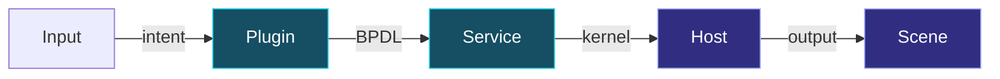
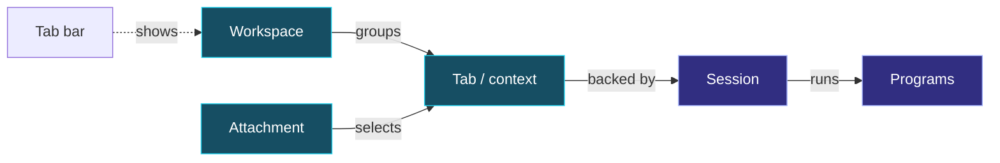
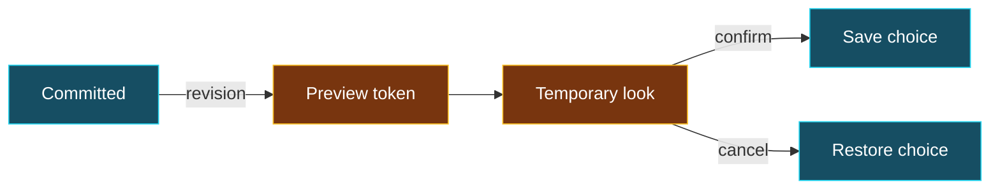
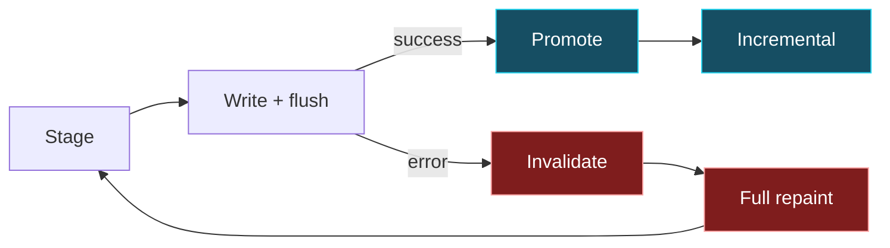

<!-- markdownlint-disable MD025 -->
<!-- Slide decks intentionally have one top-level heading per slide. -->
<!-- bmux:slide-id opening -->
<!-- bmux:block-id opening-title -->
# BMUX

<!-- bmux:block-id opening-thesis -->
A terminal workspace built around **running work, independent views, and explicit ownership**.

<!-- bmux:block-id opening-route -->
See the feature → run it here → follow the implementation.

<!-- bmux:notes -->
Quick path: “A multiplexer is the starting point. The interesting engineering is who owns the work, who owns the view, and what counts as having shown a frame.” Introduce yourself and add your actual motivation; none is invented here.
Deeper path: Explain that BMUX is early alpha. This is an implementation tour, not a compatibility or production-readiness guarantee. Each demo is an explicitly started managed execution, not a video or a command silently launched by parsing Markdown.
Rehearsal: select the approved native executable and matching plugins/worker protocol, then verify audience geometry and privacy. All six embedded scripts passed managed execution acceptance; final audience rehearsal remains separate. There is no fixed slide-count or time budget; choose depth by chapter.
Transition: “Start with a small, useful workspace.”
<!-- bmux:end-notes -->

---
<!-- bmux:slide-id splits-layout -->
<!-- bmux:block-id splits-title -->
# One workspace, several useful surfaces

<!-- bmux:block-id splits-feature -->
Keep several real commands visible together. Split the space; move focus without moving the work.

<!-- bmux:block-id demo-panes -->
<!-- bmux:component playbook-demo {"playbook":"demos/panes.dsl","title":"Splits and focus","on_leave":"stop"} -->

<!-- bmux:notes -->
Quick path: Focus the component with Tab, open with o, then manually start with r. Narrate the directory listing, kernel version, UTC clock, and the change in focus. These are actual command results, not simulated application/test status.
Deeper path: Pause with p; n executes a whole action including its waits; c resumes. Distinguish pane geometry, selected input target, and the program running underneath. This script demonstrates splits and focus, not resize or zoom.
Rehearsal: confirm command output is legible at the venue size. The managed run enables its required plugins and checks pane/focus assertions. The audience observer is output-only; script attach actions use the managed single-authority attach path, not arbitrary audience shell access. Leaving requests stop; verify cleanup acknowledgment before restart.
Transition: “The UI action has a typed contract.”
<!-- bmux:end-notes -->

---
<!-- bmux:slide-id splits-contract -->
<!-- bmux:block-id splits-contract-title -->
# A split is an operation, not a key binding

<!-- bmux:block-id excerpt-split -->
```text
    command split-pane(
        session: selector?,
        target: selector?,
        direction: pane-direction,
        ratio-pct: u32?,
    ) -> result<pane-ack, pane-mutation-error>;
```

<!-- bmux:block-id split-provenance -->
`plugins/tabs-plugin-api/bpdl/tabs-plugin.bpdl` · `tabs-commands.split-pane`

<!-- bmux:block-id split-architecture -->
Input → plugin-owned command → typed operation → execution/layout → retained composition.

<!-- bmux:notes -->
Quick path: Point out target, direction, and typed failure. A keyboard shortcut is one entry point, not the definition of splitting.
Deeper path: This is exact BPDL, not Rust or pseudocode. The same interface also exposes resize-pane and zoom-pane; this excerpt does not prove a particular keymap. API crates own contracts; runtime orchestration belongs in plugin implementations. Foundational plugins may invoke kernel requests; core must not grow tabs convenience APIs.
The arrow line is an architectural summary, not a literal call stack for every input. The retained compositor remains the authority for hit testing, occlusion, focus, and pointer routing.
Transition: “Now organize those surfaces without confusing organization with execution lifetime.”
<!-- bmux:end-notes -->

---
<!-- bmux:slide-id command-route -->
<!-- bmux:block-id command-route-title -->
# The shortcut is not the architecture

<!-- bmux:block-id command-route-diagram -->


<!-- bmux:block-id command-route-takeaway -->
**Plugins own product behavior.** Generic host mechanisms execute it; the keymap is only an entry point.

<!-- bmux:notes -->
Question: Where should a new product behavior live? Follow intent left to right, distinguishing domain decisions from execution mechanisms. Cyan is plugin-owned behavior; violet is host/rendering machinery. Arrows are logical boundaries, not every function in one literal stack. The retained scene governs interaction as well as pixels.
Sources: AGENTS.md architecture boundary; tabs-commands.split-pane; ServiceCaller::execute_kernel_request. Non-foundational plugins reach domain state through foundational services, not direct kernel shortcuts. This is the required architecture, not a claim that every historical dependency is already ideal.
<!-- bmux:end-notes -->

---
<!-- bmux:slide-id ownership -->
<!-- bmux:block-id ownership-title -->
# Running work ≠ its place in your view

<!-- bmux:block-id ownership-feature -->
Sessions describe execution lifetime. Tabs expose attachable work. Workspaces organize tabs. An attachment keeps local selection and focus.

<!-- bmux:block-id demo-navigation -->
<!-- bmux:component playbook-demo {"playbook":"demos/navigation.dsl","title":"Tabs and workspace navigation","on_leave":"stop"} -->

<!-- bmux:notes -->
Quick path: Manually run navigation. The original shell stores its PID; after a tab switch, a successful identity check computes 42. Create a generated workspace, run uname there, then return to the existing clock tab with Alt-L.
Deeper path: Personal arrangements are distinct from deliberately shared arrangements. Changing an attachment's selection does not imply that a shared layout mutation is private. Removing a personal reference is not destroying the running resource. Disconnect survival is not machine-restart survival.
Rehearsal: keep the state marker visible long enough to explain it. This passed managed script exercises real tab/workspace commands and preserved shell state, not a second attachment or independent client-focus demonstration.
Transition: “Discovery must not quietly rewrite the organization it reads.”
<!-- bmux:end-notes -->

---
<!-- bmux:slide-id ownership-map -->
<!-- bmux:block-id ownership-map-title -->
# Switching the view does not restart the work

<!-- bmux:block-id ownership-map-diagram -->


<!-- bmux:block-id ownership-map-takeaway -->
**Navigation changes selection, not process lifetime.** Removing a personal reference is not destroying the resource.

<!-- bmux:notes -->
Question: What changes when I switch tabs? Trace the attachment's selection edge, not the session-to-program edge. Solid arrows name relationships, not data flow or exclusive ownership. The dashed edge is presentation only: replacing a tab bar cannot allocate, destroy, or reorder authoritative resources.
Sources: docs/concepts.md vocabulary and INVARIANTS.md arrangement/input rules. Tab/context is compressed for this diagram; a tab is backed by a context and currently one session. Personal references and shared edits have different semantics. Independent attachment focus does not make a shared layout mutation private. Do not infer machine-restart survival.
<!-- bmux:end-notes -->

---
<!-- bmux:slide-id ownership-contract -->
<!-- bmux:block-id ownership-contract-title -->
# Discovery and placement have different jobs

<!-- bmux:block-id excerpt-catalog -->
```text
interface tabs-catalog-v1 {
    // Complete discovery in workspace order, then each workspace's tab arrangement.
    // Reading this catalog never initializes or rewrites arrangement storage.
    query list-tabs() -> result<list<tabs-state.tab-entry>, string>;
}
```

<!-- bmux:block-id catalog-provenance -->
`plugins/tabs-plugin-api/bpdl/tabs-plugin.bpdl` · `tabs-catalog-v1`

<!-- bmux:block-id ownership-boundary -->
Tabs, sessions, workspaces, clients, and permission policy are plugin domains. Core supplies neutral execution, transport, storage, and dispatch.

<!-- bmux:notes -->
Quick path: Read the “never initializes or rewrites” line. A finder can ask what exists without acquiring ownership of its arrangement.
Deeper path: The neighboring tabs-placement-v1 contract says placement appends to the destination before changing the workspace attribute, retains source references, and is retry-idempotent. Those are ownership semantics, not just labels in a tab bar. Consult INVARIANTS.md for authority, discoverability, and input-safety contracts; do not describe the schema as proof of all recovery cases.
Keep the boundary honest: neutral host mechanisms are not a second source of domain policy. Missing optional domains must not turn baseline server primitives into domain-specific core behavior.
Transition: “That separation makes a workspace-wide finder possible.”
<!-- bmux:end-notes -->

---
<!-- bmux:slide-id finder -->
<!-- bmux:block-id finder-title -->
# Find the tab, not the workspace first

<!-- bmux:block-id finder-feature -->
Search tab names and workspace context together; switch to the work you meant.

<!-- bmux:block-id demo-finder -->
<!-- bmux:component playbook-demo {"playbook":"demos/finder.dsl","title":"Cross-workspace tab discovery","on_leave":"stop"} -->

<!-- bmux:notes -->
Quick path: Start manually. From operations/logs, the script opens the real fuzzy finder, types api, and presses Enter to return to API / ready in default. Show the query and resulting selection.
Deeper path: Finder supports fuzzy, prefix, and substring matching, scope settings, and configurable ordering. Do not equate every match mode with fuzzy scoring or promise an unrehearsed shortcut.
Rehearsal: verify the picker and query are readable at audience size. The passed managed run uses single-authority attach support for actual prompt interaction under generated configuration. It does not use real-attach or custom sandbox configuration; those remain rejected.
Transition: “The catalog and the search projection stay separate.”
<!-- bmux:end-notes -->

---
<!-- bmux:slide-id finder-implementation -->
<!-- bmux:block-id finder-implementation-title -->
# Scope and search text are explicit

<!-- bmux:block-id excerpt-finder-scope -->
```rust
        .filter(|tab| {
            settings.scope == FinderScope::AllWorkspaces
                || active_workspace_id == Some(tab.workspace_id)
        })
```

<!-- bmux:block-id excerpt-finder-text -->
```rust
            let search_source = if settings.include_workspace_name {
                format!("{}/{}", entry.workspace, entry.name)
            } else {
                entry.name.clone()
            };
```

<!-- bmux:block-id finder-provenance -->
`plugins/finder-plugin/src/lib.rs` · `build_entries` · two separate excerpts

<!-- bmux:notes -->
Quick path: The scope filter decides which tabs are candidates. The second excerpt decides whether workspace names participate in search, not just display.
Deeper path: load_windows calls the generated tabs_catalog_v1 client; show_finder requests OrderedV1 matching and supplies the configured fuzzy/prefix/substring mode. These excerpts are not the fuzzy scoring algorithm. Selection is handled separately after the prompt response; discovery alone does not mutate arrangement storage.
Rehearsal: the passed script checks the rendered picker/query and asserts the selected API pane. This establishes the demonstrated api path across default/operations, not exhaustive search ordering or every matching mode.
Transition: “Appearance needs the same separation between a convenient UI and a real state contract.”
<!-- bmux:end-notes -->

---
<!-- bmux:slide-id themes -->
<!-- bmux:block-id themes-title -->
# Compose appearance; control it coherently

<!-- bmux:block-id themes-feature -->
Keep a base visual identity while layering mode cues and plugin-owned components. Preview a change without confusing it with committed selection.

<!-- bmux:block-id demo-themes -->
<!-- bmux:component playbook-demo {"playbook":"demos/themes.dsl","title":"Theme composition and control","on_leave":"stop"} -->

<!-- bmux:notes -->
Quick path: Start manually. The script opens Select Theme and previews every bundled preset plus default in alphabetical order, holding each for two seconds. After the cycle, Home and Down return to Cyberpunk, then Enter confirms it. The original shell remains running.
Deeper path: Theme files merge left to right. Separate appearance_themes and component_themes let component packs avoid replacing base chrome. The theme plugin merges extension data; the owning plugin validates/interprets it.
Rehearsal: make the preview transition legible before confirmation. The passed script uses actual managed attach input under generated configuration. It demonstrates preview and confirmation, not cancellation, conflicting revisions, or every composition combination. Real-attach and custom sandbox-config remain rejected.
Transition: “First the data being composed, then the control protocol.”
<!-- bmux:end-notes -->

---
<!-- bmux:slide-id themes-composition -->
<!-- bmux:block-id themes-composition-title -->
# A theme carries plugin extension data

<!-- bmux:block-id excerpt-theme-component -->
```toml
[plugins."bmux.decoration".unfocused]
bg            = ""
fg            = "#606060"
glyphs_custom = []
gradient_from = ""
gradient_to   = ""
style         = "rounded"
```

<!-- bmux:block-id theme-component-provenance -->
`plugins/theme-plugin/assets/themes/minimal.toml` · `plugins."bmux.decoration".unfocused`

<!-- bmux:block-id themes-composition-boundary -->
Theme selection/composition → plugin-owned extension settings → owning renderer. Not decoration policy in core.

<!-- bmux:notes -->
Quick path: This is a real bundled theme table, not an invented configuration example. It makes the ownership boundary visible: decoration settings live under the decoration plugin identity.
Deeper path: The theme README documents deep merging extension tables and component maps by ID. ThemePlugin::reapply_live_theme passes the resolved theme to try_apply_theme_extensions and publishes runtime appearance; it avoids reapplying while a preview is active. Composition does not authorize arbitrary plugin behavior or replace the retained compositor.
The empty strings and list are exact source values. Do not infer all component capabilities from this small static table.
Transition: “A picker is one client of revisioned state.”
<!-- bmux:end-notes -->

---
<!-- bmux:slide-id preview-lifecycle -->
<!-- bmux:block-id preview-lifecycle-title -->
# Preview is temporary authority, not a saved choice

<!-- bmux:block-id preview-lifecycle-diagram -->


<!-- bmux:block-id preview-lifecycle-takeaway -->
**Revision checks protect entry; the token owns the preview.** Moving the highlight is not confirmation.

<!-- bmux:notes -->
Question: Why not save on every Down key? A preview must be reversible and owned. Cyan is committed state; amber is temporary authority/appearance. Moving among candidates changes live appearance without treating each highlight as a saved selection. That repeated preview step is compressed into Temporary look; Save choice and Restore choice are outcomes, not additional state owners. Confirm and cancel are distinct operations.
Source: plugins/theme-plugin/bpdl/theme-plugin.bpdl, theme-control-v1. This is a successful-path lifecycle, not a complete error state machine. Begin can reject a stale expected revision; token operations can fail and are not unconditional transitions. Renew-preview and cleanup/expiry handling are intentionally omitted. The demo shows previews and confirmation, not all races or cancellation cases.
<!-- bmux:end-notes -->

---
<!-- bmux:slide-id themes-control -->
<!-- bmux:block-id themes-control-title -->
# Stale controls must not silently win

<!-- bmux:block-id excerpt-theme-control -->
```text
    command current() -> snapshot;
    command select(expected-revision: u64, selection: selection) -> result<snapshot, string>;
    command refresh(expected-revision: u64) -> result<snapshot, string>;
    command begin-preview(expected-revision: u64) -> result<u64, string>;
    command preview(token: u64, selection: selection) -> result<unit, string>;
    command cancel-preview(token: u64) -> result<unit, string>;
    command confirm-preview(token: u64, selection: selection) -> result<snapshot, string>;
```

<!-- bmux:block-id theme-control-provenance -->
`plugins/theme-plugin/bpdl/theme-plugin.bpdl` · `theme-control-v1` · excerpt

<!-- bmux:notes -->
Quick path: Read revision before mutation; carry the expected revision back. Preview uses an owned token rather than pretending every temporary frame is committed selection.
Deeper path: The schema's snapshot pairs revision with selection. The contract also exposes renew-preview, external forms, and component settings; the excerpt intentionally omits those. Runtime state and lifecycle belong in the implementation, not the stable API contract. See ThemePlugin::begin_preview, confirm_preview, and select_without_preview for implementation follow-up.
Rehearsal gate: an accepted appearance demo is not evidence of conflict handling unless it actually exercises conflicting revisions. No claim that source inspection replaces that test.
Transition: “Revisions also matter at the output boundary: prepared is not yet presented.”
<!-- bmux:end-notes -->

---
<!-- bmux:slide-id rendering -->
<!-- bmux:block-id rendering-title -->
# A frame is not correct until it is delivered

<!-- bmux:block-id rendering-feature -->
Layout, text, cursor, and interaction must describe the same committed scene—not a mixture of old output and new intent.

<!-- bmux:block-id demo-rendering -->
<!-- bmux:component playbook-demo {"playbook":"demos/rendering.dsl","title":"Rendering and retained output","on_leave":"stop"} -->

<!-- bmux:notes -->
Quick path: Start manually. Follow seq 1 100, entry into scrollback, Page Up/Page Down, and return to the live shell. This exercises genuine output and scrolling, not image protocols or synthetic ANSI row updates.
Deeper path: The retained compositor is the common authority for damage, clipping, focus, hit testing, and pointer routing. Different transports do not get independent scene ownership. A correct-looking screenshot alone does not prove flush-failure or stale-input handling.
Rehearsal: verify text and scrolling at actual audience dimensions. This script does not inject write/flush failures. The following code explains the failure boundary; successful text rendering is not fault-injection evidence.
Transition: “The smallest important implementation detail is only four lines.”
<!-- bmux:end-notes -->

---
<!-- bmux:slide-id frame-transaction -->
<!-- bmux:block-id frame-transaction-title -->
# Only delivered output becomes the next baseline

<!-- bmux:block-id frame-transaction-diagram -->


<!-- bmux:block-id frame-transaction-takeaway -->
**A failed flush leaves host output uncertain.** Do not promote pending cursor/graphics state or trust the old row baseline.

<!-- bmux:notes -->
Question: Why can a screenshot look right while the renderer is wrong? Incremental work depends on a known delivered baseline, not just a successfully constructed buffer. Cyan is promotion; red is repair. A partial write is not reversible: invalidation and full repaint repair assumptions, not an atomic rollback of terminal pixels.
Sources: packages/attach_pipeline/src/terminal.rs write_frame; packages/cli/src/runtime/attach/runtime.rs render_attach_frame_inner write_result branch and following cache promotion. Successfully written/flushed frames enter display capture. This diagram is terminal delivery, not a claim that a browser has already painted a received frame. The demo does not inject output failures.
<!-- bmux:end-notes -->

---
<!-- bmux:slide-id flush-boundary -->
<!-- bmux:block-id flush-title -->
# Write + flush is the commit boundary

<!-- bmux:block-id excerpt-write-frame -->
```rust
pub fn write_frame<W: Write + ?Sized>(writer: &mut W, bytes: &[u8]) -> io::Result<()> {
    writer.write_all(bytes)?;
    writer.flush()
}
```

<!-- bmux:block-id flush-provenance -->
`packages/attach_pipeline/src/terminal.rs` · `write_frame`

<!-- bmux:block-id flush-contract -->
Prepare output → deliver successfully → advance presentation state. Failure requires repair, not a pretend commit.

<!-- bmux:notes -->
Quick path: write_all can fail after partial output; flush can fail too. Neither is a successfully displayed frame. The function documentation requires committing cursor, damage, and render baselines only after success.
Deeper path: The attach caller stages pending cursor/graphics state, handles failure, and only then promotes those caches. Interaction metadata must remain tied to committed output. The four lines are a delivery primitive, not the entire transaction or proof that every host terminal displays identically.
Transition: “The caller takes failed output seriously.”
<!-- bmux:end-notes -->

---
<!-- bmux:slide-id rendering-repair -->
<!-- bmux:block-id rendering-repair-title -->
# Partial output invalidates incremental assumptions

<!-- bmux:block-id excerpt-render-repair -->
```rust
        // Encoding has advanced row baselines, but partial output is not a
        // presented frame. Repaint every row before using incremental diffs.
        for buffer in view_state.pane_buffers.values_mut() {
            buffer.prev_rows.clear();
        }
        view_state
            .dirty
            .mark_full_frame(AttachDirtySource::ManualRedraw);
        return Err(error);
```

<!-- bmux:block-id rendering-repair-provenance -->
`packages/cli/src/runtime/attach/runtime.rs` · `render_attach_frame_inner` · write-error branch

<!-- bmux:notes -->
Quick path: Incremental rendering assumes a known previous frame. After partial output, that assumption is false; clear the row baseline and request a full frame.
Deeper path: Nearby code invalidates pending Kitty host state on output failure and promotes pending cursor/graphics caches only after success. Successfully delivered frames alone enter display capture. Kitty placements and raster footprints have different lifecycles; see appendix rather than claiming one cleanup rule fits every protocol.
This is exact implementation, not a benchmark result. Fault injection and real terminal rehearsal answer different questions from the passed text-update demo.
Transition: “That gives us a better question than ‘did it look fine once?’: what evidence did the run produce?”
<!-- bmux:end-notes -->

---
<!-- bmux:slide-id playbooks-evidence -->
<!-- bmux:block-id evidence-title -->
# The demonstration can carry its own checks

<!-- bmux:block-id evidence-feature -->
Scripted actions, explicit waits, assertions, and retained output make the story inspectable. A run's status matters as much as its final frame.

<!-- bmux:block-id demo-evidence -->
<!-- bmux:component playbook-demo {"playbook":"demos/evidence.dsl","title":"Actions, checks, and evidence","on_leave":"stop"} -->

<!-- bmux:notes -->
Quick path: Start manually. Point to the computed 42 in each pane, assert-layout pane_count=2, assert-screen, and snapshot verified-demo in the real script. There is no printed PASS banner; checks inspect actual arithmetic output.
Deeper path: A playbook is executable input, not a passive slide asset. Parser-only consumers do not enable native execution. CLI and managed workers share the playbook executor; a host adapter supplies platform primitives rather than implementing a separate action language. Evidence only supports the assertions actually made.
Rehearsal: review the frozen source/include closure and redact retained artifacts before sharing. The six scripts exercise real commands through the owned attach; their arithmetic results are not repository test/benchmark outcomes. A retained snapshot supports the actual assertions, not arbitrary claims about unseen behavior.
Transition: “Embedding execution requires restrictions, not just a pretty component.”
<!-- bmux:end-notes -->

---
<!-- bmux:slide-id demo-authority -->
<!-- bmux:block-id demo-authority-title -->
# One input authority; many read-only views

<!-- bmux:block-id demo-authority-diagram -->


<!-- bmux:block-id demo-authority-takeaway -->
**The audience sees the execution owner's view.** It does not get a second attach, shell input, or authority to start work.

<!-- bmux:notes -->
Question: Is the embedded demo a real UI, a recording, or another controller? The worker drives the actual owned attach. The presenter reads a bounded latest complete repair, validates lifetime identity/revision, and paints retained output; it does not reconstruct the scene from pane text. Cyan is execution/input authority; violet is the read-only projection. Arrows show the data path, not extra processes: browser output is optional.
Sources: plugins/presenter-plugin/src/playbook.rs admission; packages/playbook/src/managed_display.rs DisplayPacket; plugins/presenter-plugin/src/playbook_capture.rs ManagedCaptureCursor; playbook_observer.rs. Generation/epoch/revision fencing are simplified here. A missing repair is not completion. Stop requests, cleanup acknowledgment, and restart are separate lifecycle facts; output retention is bounded, not a complete output history.
<!-- bmux:end-notes -->

---
<!-- bmux:slide-id playbooks-boundary -->
<!-- bmux:block-id playbooks-boundary-title -->
# Managed execution has an explicit admission boundary

<!-- bmux:block-id excerpt-managed-admission -->
```rust
        if !matches!(
            deck.config.driver,
            bmux_playbook::types::PlaybookDriver::Sandbox
        ) || deck.config.sandbox_config_file.is_some()
        {
            return Err(
                "managed execution requires sandbox driver and generated isolated configuration"
                    .into(),
            );
        }
```

<!-- bmux:block-id managed-provenance -->
`plugins/playbook-plugin/src/runner.rs` · `Owner::prepare`

<!-- bmux:block-id managed-safety -->
Explicit `--allow-playbooks` approval. Manual start. Owned stop/cleanup. Isolated paths are **not** a security sandbox for shell actions.

<!-- bmux:notes -->
Quick path: This rejects real-attach and custom sandbox-config. It is why an ordinary fixture cannot automatically become an embedded demo.
Deeper path: Owner::prepare also rejects BMUX_/XDG_ runtime-selector environment overrides. Sources/includes are frozen and closure-checked; changed executable bytes require fresh approval. Generation-fenced lifecycle control and retained output are distinct from arbitrary terminal input. A stop request is not cleanup acknowledgment; Escape only hides the overlay.
Rehearsal: select an approved immutable native executable; protocol compatibility does not establish executable content identity. Do not describe isolation as protection from untrusted shell commands. Finder/themes use the supported managed attach authority without weakening admission.
Transition: “The same separation—content versus execution—also makes the presentation reusable.”
<!-- bmux:end-notes -->

---
<!-- bmux:slide-id presentation-reuse -->
<!-- bmux:block-id reuse-title -->
# This deck is another application of the UI stack

<!-- bmux:block-id reuse-stack -->
Markdown content + stable identities → retained composition → local presentation and public audience delivery.

<!-- bmux:block-id reuse-boundary -->
The local presenter owns executable controls. A browser audience receives public content and rendered live surfaces—not the worker or private speaker notes.

<!-- bmux:block-id reuse-modes -->
Responsive document delivery composes public content locally. Fixed-frame delivery retains producer geometry. They are distinct contracts.

<!-- bmux:notes -->
Quick path: Use the current slide as the example: ordinary text and an embedded live surface share a presentation model. A browser audience is a read-only audience, not a remote shell or controller.
Deeper path: bmux_tui is neutral geometry/painting/input; components build on primitives; runtime handles lifecycle/scheduling without depending on components. Product behavior stays in apps/plugins. Semantic document delivery and fixed-frame delivery must be selected deliberately, with matching assets; changing a URL cannot manufacture the other host representation.
Rehearsal gate: HTTP frame acceptance is not browser/Canvas acceptance. Only show a browser after validating this exact native/WASM combination, delivery mode, authentication, and privacy. Preserve the announced origin and capability fragment privately; never publish capability URLs, observer paths, or private evidence. No browser keyboard-control or logical selection/copy claim for embedded rasters.
Transition: “Privacy is visible in the portable model, not just a presenter convention.”
<!-- bmux:end-notes -->

---
<!-- bmux:slide-id presentation-privacy -->
<!-- bmux:block-id privacy-title -->
# Public content is not presenter state

<!-- bmux:block-id excerpt-private-notes -->
```rust
    /// Private by default even when callers serialize a local deck directly.
    #[serde(skip)]
    pub notes: SpeakerNotes,
```

<!-- bmux:block-id privacy-provenance -->
`packages/presenter/src/model.rs` · `Slide::notes`

<!-- bmux:block-id privacy-contract -->
Portable content excludes executable factories. Public audience decoding also rejects injected private projection fields.

<!-- bmux:notes -->
Quick path: The speaker notes are omitted during serialization. That is stronger than merely hiding a notes panel in CSS.
Deeper path: AudienceDocument::decode bounds the document and rejects private fields. The rejects_private_projection_fields test rejects a private source projection and an injected notes field. Public projection, bounded resources, and committed surface revisions work together; this excerpt alone is not a whole-system privacy proof.
Rehearsal gate: verify the real audience output contains no notes or private paths and that screen sharing captures the audience rather than the presenter viewport. Browser capability URLs and retained evidence remain private even when the document model is public.
Transition: “The useful result is not the list of features; it is a set of boundaries we can explain and test.”
<!-- bmux:end-notes -->

---
<!-- bmux:slide-id close -->
<!-- bmux:block-id close-title -->
# Useful workspaces need trustworthy boundaries

<!-- bmux:block-id close-takeaways -->
1. Separate running work from its organization and each viewer's selection.
2. Put domain behavior behind plugin-owned contracts.
3. Advance presentation authority only after successful delivery.
4. Make demonstrations produce evidence—not just animation.

<!-- bmux:block-id close-invitation -->
BMUX is early alpha. Ask about the feature, the contract, or the failure boundary.

<!-- bmux:notes -->
Quick path: Recap the path from useful split panes to ownership, discovery, appearance, delivery, and evidence. The next slide is an explicitly started live finale; the appendix remains optional.
Deeper path: Revisit a source slide or inspect an accepted run's retained output. Avoid invented performance figures, maturity claims, adoption, or roadmap commitments. Let the audience choose the layer.
The six original managed demos passed; final audience/privacy rehearsal and browser/Canvas acceptance remain distinct. Architecture intent, inspected implementation, and executed evidence are three different levels of confidence.
<!-- bmux:end-notes -->

---
<!-- bmux:slide-id jev-finale -->
<!-- bmux:block-id jev-title -->
# One more thing: can Jev fly?

<!-- bmux:block-id jev-contract -->
Jev chooses **flap or wait**. BMUX hosts the real terminal application.
Agent-paced physics waits for each decision; crashes start another attempt.

<!-- bmux:block-id demo-jev-flappy -->
<!-- bmux:component playbook-demo {"playbook":"demos/jev-flappy.dsl","title":"Jev plays Flappy Bird","on_leave":"stop"} -->

<!-- bmux:notes -->
Explicitly start the approved demo. This is live judgement API usage, not a recording or a hidden scripted pilot. It runs until Stop or leaving this slide, including across game-over retries. Request timeouts do not impose a demo lifetime.
Configure the key before launching the presenter; see demos/jev-flappy.md. The game is a declared playbook resource, so approval and source freezing cover its bytes. Runtime control paths are generated automatically; no app-path or socket environment setup is needed. Never put keys into scripts or displayed commands. Pause/resume/restart of gameplay use private application controls; presenter script Pause is not application pause. Presenter Stop/Restart and leaving the slide own managed sandbox cleanup.
Keep this running during Q&A if desired. Requests incur ongoing provider usage. Network errors freeze physics and use bounded retry backoff; do not promise an unbeatable pilot or imply that offline tests prove live provider performance.
<!-- bmux:end-notes -->
