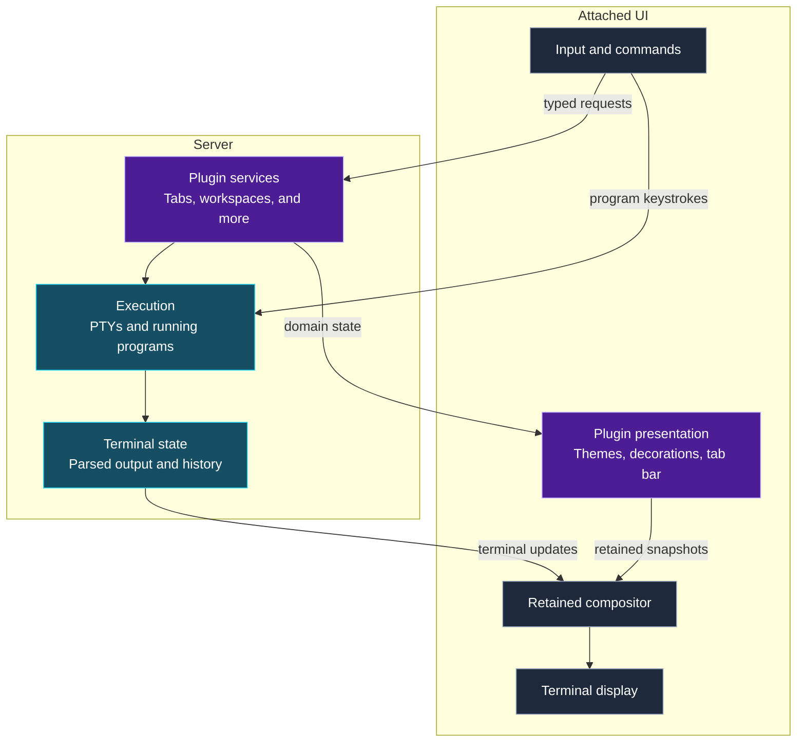

<!-- markdownlint-disable MD025 -->

<!-- Slide decks intentionally have one top-level heading per slide. -->
<!-- bmux:slide-id opening -->
<!-- bmux:block-id opening-title -->
# BMUX: a programmable terminal workspace

<!-- bmux:block-id opening-body -->
Keep your shells, editors, builds, and logs together.

**Arrange the work. Find it again. Automate the interaction.**

Today: live terminal workflows, composable themes, tests that inspect the screen,
and the Rust libraries behind BMUX’s UI.

Early alpha · real demos and implementation examples

<!-- bmux:notes -->
BMUX: real terminal work, programmable UI. Early alpha.
<!-- bmux:end-notes -->
---
<!-- bmux:slide-id why-bmux -->
<!-- bmux:block-id why-bmux-title -->
# The hard part is finding your work again

<!-- bmux:block-id why-bmux-body -->
Imagine three things running: a build, a shell for changes, and logs.

- **See them together** without juggling terminal windows.
- **Find them later** without remembering which tab you used.
- **Repeat the setup** without remembering every keystroke.

We will do those things first. Then open the hood.

<!-- bmux:notes -->
Build, edit, logs. Arrange once; find them again.
<!-- bmux:end-notes -->
---
<!-- bmux:slide-id mental-model -->
<!-- bmux:block-id mental-model-title -->
# Three names you need before the first demo

<!-- bmux:block-id mental-model-body -->
| Name | Think of it as | In this tour |
| --- | --- | --- |
| **Pane** | A terminal surface for a shell or program | Commands visible side by side |
| **Tab** | A selectable view of running work | Return to the original shell |
| **Workspace** | A named group of tabs | Find a tab across groups |

**Switching what you see is not the same as restarting what runs.**

Simplified user model—not an execution-lifetime or ownership diagram.

<!-- bmux:notes -->
Pane = terminal view. Tab = arrangement. Workspace = group of tabs.
<!-- bmux:end-notes -->
---
<!-- bmux:slide-id splits-layout -->
<!-- bmux:block-id splits-title -->
# Three commands, one useful view

<!-- bmux:block-id chapter-work -->
Work you can see and find

<!-- bmux:block-id splits-feature -->
Watch one terminal become three panes: a file list, system information, and current UTC time.

**Notice:** focus moves between panes; each pane keeps its own output.

<!-- bmux:block-id demo-panes -->
<!-- bmux:component playbook-demo {"playbook":"demos/panes.dsl","title":"Splits and focus","on_leave":"stop"} -->

<!-- bmux:notes -->
Run: Tab → o → r. Point: three outputs; focus moves. Failure: stop, continue.
<!-- bmux:end-notes -->
---
<!-- bmux:slide-id ownership -->
<!-- bmux:block-id ownership-title -->
# Change the view, keep the work

<!-- bmux:block-id ownership-feature -->
We will leave a shell, visit another tab and workspace, then return.

**Notice:** we return to the same running shell—not a newly started one.
Its saved process ID still matches, and its temporary file is still there.

<!-- bmux:block-id demo-navigation -->
<!-- bmux:component playbook-demo {"playbook":"demos/navigation.dsl","title":"Tabs and workspace navigation","on_leave":"stop"} -->

<!-- bmux:notes -->
Run: Tab → o → r. Point: original shell check prints 42. Failure: stop; do not claim success.
<!-- bmux:end-notes -->
---
<!-- bmux:slide-id ownership-map -->
<!-- bmux:block-id ownership-map-title -->
# The process ID tells us which shell we returned to

<!-- bmux:block-id ownership-map-body -->
`$$` is the current shell’s process ID. Save it before switching tabs:

```sh
tour_origin=$$
```

After returning, compare the saved ID with the current one:

```sh
test "$tour_origin" = "$$"
```

The demo also writes **42 lines to a temporary file** with `seq 1 42` and reads
its line count with `wc -l`. That is just a visible file check, not part of navigation.

These two checks are combined in `demos/navigation.dsl`.

<!-- bmux:notes -->

PID proves same shell. File supplies a second, visible check. Read these separately.
<!-- bmux:end-notes -->
---
<!-- bmux:slide-id finder -->
<!-- bmux:block-id finder-title -->
# Remember “api”, not where you put it

<!-- bmux:block-id finder-feature -->
Start in another workspace. Open **Find Tab**, type `api`, and select it.

**Notice:** we return to the tab with the earlier Linux output.
The finder selects that existing tab; it does not start a new terminal.

<!-- bmux:block-id demo-finder -->
<!-- bmux:component playbook-demo {"playbook":"demos/finder.dsl","title":"Cross-workspace tab discovery","on_leave":"stop"} -->

<!-- bmux:notes -->
Run: Tab → o → r. Point: api → earlier Linux output. Failure: stop, continue.
<!-- bmux:end-notes -->
---
<!-- bmux:slide-id themes -->
<!-- bmux:block-id themes-title -->
# Try a different look without committing to it

<!-- bmux:block-id chapter-appearance -->
A workspace that feels like yours

<!-- bmux:block-id themes-feature -->
The real theme picker previews bundled presets, then confirms Cyberpunk.

**Notice:** highlighting changes the appearance; Enter chooses what to keep.
The shell is still there underneath the picker.

<!-- bmux:block-id demo-themes -->
<!-- bmux:component playbook-demo {"playbook":"demos/themes.dsl","title":"Theme composition and control","on_leave":"stop"} -->

<!-- bmux:notes -->
Run: Tab → o → r. Point: preview, cancel, restore. Failure: stop, continue.
<!-- bmux:end-notes -->
---
<!-- bmux:slide-id themes-composition -->
<!-- bmux:block-id themes-composition-title -->
# A theme can style a plugin’s part of the screen

<!-- bmux:block-id theme-reading-key -->
This bundled TOML configures an **unfocused decoration**: a pane that is not active.

<!-- bmux:block-id excerpt-theme-component -->
```toml
[plugins."bmux.decoration".unfocused]
bg            = ""
fg            = "#606060"
glyphs_custom = []
gradient_from = ""
gradient_to   = ""
style         = "rounded"
```

<!-- bmux:block-id theme-component-provenance -->

`plugins/theme-plugin/assets/themes/minimal.toml` · `plugins."bmux.decoration".unfocused`

<!-- bmux:block-id themes-composition-boundary -->
**Example:** `fg` sets this unfocused decoration’s foreground color.
`style = "rounded"` selects its rounded style. The decoration plugin interprets these settings.

<!-- bmux:notes -->
Theme declares settings; decoration plugin interprets them.
<!-- bmux:end-notes -->
---
<!-- bmux:slide-id theme-layers -->
<!-- bmux:block-id theme-layers-title -->
# A theme can compose behavior, not just colors

<!-- bmux:block-id theme-layers-body -->
The Pong theme selects animation and declares which pieces participate:

```toml
[plugins."bmux.decoration".animation]
hz   = 16
kind = "pong"

[settings.component_settings.pong]
components = ["pong.ball", "pong.paddles", "pong.score"]
```

The theme plugin reads the theme. The decoration plugin supplies the animation.
The compositor places the ball, paddles, score, and terminal content together.

Source: `plugins/theme-plugin/assets/themes/pong.toml`

<!-- bmux:notes -->

Colors → animation → component list. Separate owners, one composed screen.
<!-- bmux:end-notes -->
---
<!-- bmux:slide-id visual-adapter -->
<!-- bmux:block-id visual-adapter-title -->
# Pong can bounce off the contents of a pane

<!-- bmux:block-id visual-adapter-body -->
```text
Rendered pane cells
    ↓ presence-bitset adapter (client-side)
Compact occupancy mask + grid revision
    ↓ visual payload sent to the decoration plugin
Lua: is the next cell occupied?
    ↓
Bounce the ball; compose it with the terminal content
```

The adapter turns the grid into **one presence bit per cell**. Lua does not need
to parse terminal output or inspect every character on each collision check.

Enable **Bounce off terminal content** in Pong settings; it is off by default.

<!-- bmux:notes -->

Content becomes collision data. Projection happens before transport; Lua consumes the mask.
<!-- bmux:end-notes -->
---
<!-- bmux:slide-id visual-adapter-contract -->
<!-- bmux:block-id visual-adapter-contract-title -->
# Declare exactly which visual data the plugin needs

<!-- bmux:block-id visual-adapter-contract-body -->
```toml
[[plugins."bmux.decoration".components."pong.ball".visual_adapters]]
adapter    = "bmux.visual.presence-bitset"
area       = "content"
dirty_only = true
id         = "pong.content-presence"
max_bytes  = 16384
max_hz     = 30
scope      = "all-panes"
```

`area` chooses the pane content. `dirty_only` avoids unchanged projections.
`max_bytes` and `max_hz` bound payload size and update rate.

The adapter is plugin-owned; the host carries the declared request and payload.

Source: `plugins/theme-plugin/assets/themes/pong.toml`

<!-- bmux:notes -->

Point: content region, dirty-only, byte/rate limits. No Pong-specific core API.
<!-- bmux:end-notes -->
---
<!-- bmux:slide-id visual-adapter-lookup -->
<!-- bmux:block-id visual-adapter-lookup-title -->
# A collision check is a word lookup and a bit test

<!-- bmux:block-id visual-adapter-lookup-body -->
How does a fast-moving ball avoid tunneling through terminal text?

```lua
local function occupied(mask, x, y)
    if mask == nil or x < 0 or y < 0
        or x >= mask.width or y >= mask.height then
        return false
    end
    local index = y * mask.words_per_row + math.floor(x / 32)
    local word = visual_bitset_word(mask, index)
    return math.floor(word / (2 ^ (x % 32))) % 2 == 1
end

-- Schematic traversal: helpers abbreviate the real grid-crossing loop.
-- Reconcile inside/outside state when the mask revision changes.
local inside = reconcile_visual_revision(game)
for crossing in crossed_cells(game, max_ms) do
    local filled = occupied(game.visual, crossing.x, crossing.y)
    if filled and not inside then
        local hit_x, hit_y = resolve_content_hit_axes(
            game, crossing.x, crossing.y,
            crossing.prev_x, crossing.prev_y,
            crossing.hit_x, crossing.hit_y)
        return collision_at(crossing.time, hit_x, hit_y)
    end
    inside = filled
end
```

**Test the path, not just the destination.** Neighbor occupancy resolves corner hits;
the collision candidate feeds the later bounce response. Traversal helpers above
are schematic, not Lua APIs provided by BMUX.

Simplified from `plugins/decoration-plugin/assets/decorations/pong.lua` · `visual_bitset_occupied`, `visual_collision_candidate`. Names and plumbing are shortened; not a standalone program.

<!-- bmux:notes -->

Lookup first; scroll to crossed cells and hit axes. Revision changes reconcile occupancy. This is simplified algorithm structure, not copy/paste Lua.
<!-- bmux:end-notes -->
---
<!-- bmux:slide-id playbooks-intro -->
<!-- bmux:block-id playbooks-intro-title -->
# What if the demo could check itself?

<!-- bmux:block-id playbooks-intro-body -->
A **playbook** is a readable script for terminal actions **and checks**.

**Set up real work → act on the real UI → wait for output → check it.**

The demos so far were playbooks. Now we will read one.

Not a video. Not a slide that prints “success” without doing the work.

<!-- bmux:notes -->
Input + waits + assertions + snapshots. A demo can also be a test.
<!-- bmux:end-notes -->
---
<!-- bmux:slide-id playbooks-evidence -->
<!-- bmux:block-id evidence-title -->
# Make the result prove something

<!-- bmux:block-id chapter-evidence -->
Repeat the work; inspect the result

<!-- bmux:block-id evidence-feature -->
Create 42 numbered records. Read them from a second pane.
Check **42 records, sum 903, two panes**—then retain a snapshot.

**Notice:** the checks read real output, not just the command you typed.

<!-- bmux:block-id demo-evidence -->
<!-- bmux:component playbook-demo {"playbook":"demos/evidence.dsl","title":"Actions, checks, and evidence","on_leave":"stop"} -->

<!-- bmux:notes -->
Run: Tab → o → r. Point: checked visible output. Failure: stop; failed check is not a pass.
<!-- bmux:end-notes -->
---
<!-- bmux:slide-id playbook-source -->
<!-- bmux:block-id playbook-source-title -->
# Read the checks like a tiny test

<!-- bmux:block-id excerpt-playbook-check -->
```text
wait-for pattern='(?m)^42 903\s*$'
assert-layout pane_count=2
assert-screen matches='(?m)^42 903\s*$'
# Keep a named snapshot only after both the structural and output checks pass.
snapshot id='verified-demo'
```

<!-- bmux:block-id playbook-source-provenance -->

`demos/evidence.dsl` · output/layout checks → named snapshot

<!-- bmux:block-id playbook-source-contract -->
`wait-for`: wait for the complete result line.
`assert-layout`: require two panes. `assert-screen`: check what is displayed.
`snapshot`: retain the result **after** the checks pass.

<!-- bmux:notes -->
Read input, wait, assertion, snapshot in order. No fixed sleep as proof.
<!-- bmux:end-notes -->
---
<!-- bmux:slide-id playbook-catalog -->
<!-- bmux:block-id playbook-catalog-title -->
# What else do we test with playbooks?

<!-- bmux:block-id playbook-catalog-body -->
| Use case | Existing fixture (`packages/cli/tests/fixtures/playbooks/`) |
| --- | --- |
| Focus and splits | `render_assert_focus_change.dsl`, `render_assert_split_pane.dsl` |
| Resizing | `render_assert_resize_viewport.dsl` |
| Tab search and navigation | `tab_navigation_finder_real_attach.dsl` |
| Search relevance | `finder_relevance.dsl`, `finder_cross_workspace_recency.dsl` |
| Streaming history | `history_burst_live.dsl`, `history_burst_frozen.dsl` |
| Reflow while scrolling | `structured_reflow_scrollback.dsl` |
| Alternate-screen recovery | `alternate_screen_resize_shell_liveness.dsl` |
| Copying history | `history_alternate_copy.dsl` |

The same input/wait/assert/snapshot pattern checks different user workflows.

<!-- bmux:notes -->
Fast scan: not just demos. Focus, resize, search, history, reflow, recovery, copy.
<!-- bmux:end-notes -->
---
<!-- bmux:slide-id architecture-overview -->
<!-- bmux:block-id architecture-overview-title -->
# How BMUX fits together

<!-- bmux:block-id architecture-overview-body -->


<!-- bmux:notes -->

Follow a split request forward, then output back. Keystrokes target the program. Plugins organize; one compositor combines surfaces. Attachment loss does not end execution.
<!-- bmux:end-notes -->
---
<!-- bmux:slide-id command-route -->
<!-- bmux:block-id command-route-title -->
# The plugin makes three concrete decisions

<!-- bmux:block-id command-route-diagram -->
Who decides what a split means? Follow the policy, request, and result.

```rust
// Tabs plugin: choose policy before crossing the service boundary.
if policy != RuntimeDefault {
    validate_directory_split_target(target)?;
}
let session_id = resolve_session_id(caller, session)?;
let target = resolve_target_pane_id(caller, session_id, target)?;
let ratio = ratio_pct.unwrap_or(50).clamp(10, 90) as u8;
let mut client = dispatch_client(caller);

let ack = if policy == RuntimeDefault {
    block_on_typed_dispatch(pane_commands::client::split_pane(
        &mut client, session_id, target, direction, ratio,
    ))??  // Transport failure and service failure are distinct.
} else {
    let target = target.ok_or("explicit target required")?;
    let options = resolve_split_options(caller, policy, session_id, target)?;
    block_on_typed_dispatch(spawn_commands::client::split_shell(
        &mut client, session_id, target, direction, ratio, options,
    ))??
};
emit_pane_event(PaneEvent::Opened {
    pane_id: ack.pane_id, session_id: ack.session_id,
});
Ok(ack)
```

**Resolve → choose policy → call a generated client → publish the result.**
The tabs plugin owns the policy; it does not reach into another plugin’s private runtime.

Simplified from `plugins/tabs-plugin/src/lib.rs` · `split_pane_with_policy`. Names and plumbing are shortened; not a standalone program.

<!-- bmux:notes -->

Pause at target validation, then the two generated calls, then the event. Scroll as needed. Double ? abbreviates separate transport/service error mapping.
<!-- bmux:end-notes -->
---
<!-- bmux:slide-id plugin-contract -->
<!-- bmux:block-id plugin-contract-title -->
# A typed contract connects plugins—not private Rust state

<!-- bmux:block-id plugin-contract-body -->
**Declare → generate → implement → invoke → return a typed result.**

The pane-runtime API declares the split operation in BPDL:

```text
command split-pane(
    session_id: uuid,
    target: uuid?,
    direction: string,
    ratio_percent: u8,
) -> result<pane-ack, pane-command-error>;
```

The tabs plugin consumes its generated client (shortened namespaces):

```rust
let reply = block_on_typed_dispatch(
    pane_commands::client::split_pane(
        &mut client, session_id, target, direction, ratio,
    ),
)?;                 // Invocation/transport error.
let ack = reply?;   // Typed service rejection.
```

On the provider side, service dispatch reaches the pane-runtime handler:

```rust
let direction = parse_split_direction(&req.direction)?;
let session_id = SessionId(req.session_id);
ensure_session_mutation_allowed(ctx, session_id, "pane.split")?;
let pane_id = handle.split_pane(
    session_id, target_selector(req.target), direction,
)?;
emit_attach_view_changed_scene(session_id);
Ok(PaneAck { session_id: req.session_id, pane_id })
```

The provider owns execution state and authorization. The caller imports neither
its runtime manager nor its storage layout.

Simplified from `plugins/pane-runtime-plugin-api/bpdl/pane-runtime-plugin.bpdl`,
`plugins/pane-runtime-plugin/src/handlers/pane_commands.rs` · `split_pane`,
and `plugins/tabs-plugin/src/lib.rs` · `split_pane_with_policy`.
The declaration is an excerpt; client error conversions are omitted.

**Bundling/loading is a deployment choice; typed contracts are the composition boundary.**
This is not a claim that arbitrary plugin versions are interchangeable.

<!-- bmux:notes -->

Contract first, generated client second, provider-owned implementation third.
No handwritten transport envelope or private runtime import. Scroll to the result layers.
<!-- bmux:end-notes -->
---
<!-- bmux:slide-id rendering -->
<!-- bmux:block-id rendering-title -->
# Output has to stay understandable as it moves

<!-- bmux:block-id rendering-feature -->
A real command prints a numbered catalog. Scroll up, scroll back, then run the clock.

**Notice:** scrollback—earlier terminal output—is inspectable. Returning to the live end lets the shell show new output.
The next slide shows two ways to read history while the program keeps running.

<!-- bmux:block-id demo-rendering -->
<!-- bmux:component playbook-demo {"playbook":"demos/rendering.dsl","title":"Rendering and retained output","on_leave":"stop"} -->

<!-- bmux:notes -->
Run: Tab → o → r. Point: scroll up, return to live output. Failure: stop, continue.
<!-- bmux:end-notes -->
---
<!-- bmux:slide-id scrollback-modes -->
<!-- bmux:block-id scrollback-modes-title -->
# Read live history—or freeze a snapshot

<!-- bmux:block-id scrollback-modes-body -->
| Mode | While new output arrives | Useful for |
| --- | --- | --- |
| **Live** (default) | History continues updating; the viewed position is preserved | Following logs while checking earlier lines |
| **Frozen** | The history being read is an immutable snapshot | Inspecting a stable section of busy output |

```toml
[behavior.scrollback]
mode = "frozen"
max_frozen_panes = 4
auto_unfreeze_after = 60
persist_pane_modes = true
```

Illustrative config: cap frozen panes and unfreeze after 60 seconds.
Per-pane rules can match command, name, or shell; the first matching rule wins.

Source: `packages/config/src/lib.rs` · `ScrollbackBehaviorConfig`

<!-- bmux:notes -->

Frozen history does not pause the process. Zero limits mean unlimited/disabled; shown values are examples.
<!-- bmux:end-notes -->
---
<!-- bmux:slide-id tui-libraries -->
<!-- bmux:block-id tui-libraries-title -->
# The UI libraries are useful outside BMUX

<!-- bmux:block-id tui-libraries-body -->
| Crate | What you build with it |
| --- | --- |
| `bmux_tui` | Geometry, layout, styled text, buffers, component and paint primitives |
| `bmux_tui_components` | Reusable controls: inputs, lists, tables, dialogs, viewers, charts |
| `bmux_tui_runtime` | Event admission, scheduling, commands, timers, redraw cadence, terminal lifecycle |

**Your application owns its state, actions, and effects.**

The runtime depends on primitives, not on the component library.
Components do not need the runtime; primitives depend on neither.

Source: `docs/tui-runtime.md` · layer ownership

<!-- bmux:notes -->
Three libraries, not a monolithic app framework. Product-neutral, directional dependencies.
<!-- bmux:end-notes -->
---
<!-- bmux:slide-id tui-compose -->
<!-- bmux:block-id tui-compose-title -->
# Compose controls with measured layout and scoped paint

<!-- bmux:block-id tui-compose-body -->
A control is more than a constructor: it participates in a shared geometry contract.

```rust
// Schematic component lifecycle; state belongs to the application.
struct SavePanel { save: ButtonState, saved: bool }

fn layout(&self, constraints, cx) -> LayoutNode {
    ButtonComponent::new("save", "Save", &self.save)
        .layout(constraints, cx)
}

fn paint(&self, committed_layout, cx) {
    ButtonComponent::new("save", "Save", &self.save)
        .paint(committed_layout, cx);
}

fn event(&mut self, event, committed_layout, cx) -> EventOutcome {
    // visible_rect abbreviates conversion through the scoped event context.
    let area = visible_rect(committed_layout, cx);
    let outcome = Button::new("Save").handle_event(area, &mut self.save, event);
    if outcome == ButtonOutcome::Pressed {
        self.saved = true; // Application decision, not framework policy.
    }
    if outcome.needs_redraw() { EventOutcome::Redraw }
    else if outcome.is_handled() { EventOutcome::Handled }
    else { EventOutcome::Ignored }
}
```

**One geometry for measurement, painting, and interaction.** A parent scopes both
paint and event contexts to the same child placement. This sketch abbreviates
trait signatures and geometry conversion, not application ownership.

Simplified from `docs/tui-runtime.md` and `packages/tui-components/src/button.rs`. Names and plumbing are shortened; not a standalone program.

<!-- bmux:notes -->

State → layout → paint → event. Emphasize same committed geometry and caller-owned state; no independent hit rectangles.
<!-- bmux:end-notes -->
---
<!-- bmux:slide-id tui-features -->
<!-- bmux:block-id tui-features-title -->
# Bring the controls you need

<!-- bmux:block-id tui-features-body -->
```toml
bmux_tui_components = { version = "0.0.1-alpha.1", default-features = false, features = [
    "dialog",
    "selectable-list",
    "text-input-box",
] }
```

No default component set. Composed controls enable their own prerequisites.
Bundles include `forms`, `navigation`, `data-display`, `overlays`, and `text-editing`.

Next: code paired with the real native components. The examples below are linked
into the presenter; the code snippets are explanations, not evaluated source.
Tab focuses a component; Escape returns to slide navigation.

Source: `packages/tui-components/README.md`

<!-- bmux:notes -->

Opt in per control. Gallery: move quickly; pause only for questions.
<!-- bmux:end-notes -->
---
<!-- bmux:slide-id tui-button -->
<!-- bmux:block-id tui-button-title -->
# Buttons

<!-- bmux:block-id tui-button-body -->
An action with caller-owned pressed/focus state. Use for Save, Cancel, or a command bar.

```rust
ButtonComponent::new("save", "Save", &state);
```

Save button with activation count. Enter/Space activates.

<!-- bmux:block-id gallery-button -->

<!-- bmux:component tui-gallery {"kind":"button"} -->

<!-- bmux:notes -->
Buttons: An action with caller-owned pressed/focus state. Next.
<!-- bmux:end-notes -->
---
<!-- bmux:slide-id tui-checkbox -->
<!-- bmux:block-id tui-checkbox-title -->
# Checkboxes

<!-- bmux:block-id tui-checkbox-body -->
An independent on/off setting; keep the setting in application state.

```rust
CheckboxComponent::new("enabled", "Enable", &state);
```

Enable starts unchecked. Space toggles it.

<!-- bmux:block-id gallery-checkbox -->

<!-- bmux:component tui-gallery {"kind":"checkbox"} -->

<!-- bmux:notes -->
Checkboxes: An independent on/off setting; keep the setting in application state. Next.
<!-- bmux:end-notes -->
---
<!-- bmux:slide-id tui-radio-group -->
<!-- bmux:block-id tui-radio-group-title -->
# Radio groups

<!-- bmux:block-id tui-radio-group-body -->
Choose one option from a small visible set, such as a delivery mode.

```rust
RadioGroupComponent::new("choice", &options, &state);
```

Live / Frozen / Automatic. Arrow keys move; Space selects.

<!-- bmux:block-id gallery-radio-group -->

<!-- bmux:component tui-gallery {"kind":"radio-group"} -->

<!-- bmux:notes -->
Radio groups: Choose one option from a small visible set, such as a delivery mode. Next.
<!-- bmux:end-notes -->
---
<!-- bmux:slide-id tui-text-input-box -->
<!-- bmux:block-id tui-text-input-box-title -->
# Text input boxes

<!-- bmux:block-id tui-text-input-box-body -->
Follow text from initialization through an edit to the next painted frame.

```rust
TextInputBoxComponent::new("name", policy, &text)
    .policy(TextInputBoxPolicy::field().focused(true));
```

<!-- bmux:block-id gallery-text-input-box -->

<!-- bmux:component tui-gallery {"kind":"text-input-box"} -->

Implementation walkthrough:

```rust
// Application setup: buffer, editing policy, and viewport.
let text = RefCell::new(TextInputState::new(TextEditBuffer::from_text("Ada")));
let policy = TextInputPolicy::chat_composer();
text.borrow_mut().set_content_area(content_area, &policy);

// Application event handler; release the mutable borrow before painting.
{
    let mut state = text.borrow_mut();
    state.set_content_area(content_area, &policy);
    match TextInputControl::new(&policy).handle_event(&mut state, event) {
        TextInputOutcome::Edited => {
            message = format!("Text: {}", state.buffer().text());
            request_redraw(); // Schematic application action.
        }
        TextInputOutcome::Redraw => request_redraw(),
        _ => {}
    }
}

// Paint from that same caller-owned state, not a second text buffer.
let input = TextInputBoxComponent::new("name", policy, &text);
let layout = input.layout(constraints, layout_cx);
input.paint(&layout, paint_cx);
```

**The application owns the buffer; the control interprets edits.** The containing
application routes focus and supplies geometry. `request_redraw` is schematic.

Simplified from `examples/tui-components-inputs/src/lib.rs` · `new`, `handle_text_event`; `packages/tui-components/src/text_input_box.rs`. Names and plumbing are shortened; not a standalone program.

<!-- bmux:notes -->

Pause on caller-owned buffer, then Edited versus Redraw, then painting the same state.
<!-- bmux:end-notes -->
---
<!-- bmux:slide-id tui-select-dropdown -->
<!-- bmux:block-id tui-select-dropdown-title -->
# Select dropdowns

<!-- bmux:block-id tui-select-dropdown-body -->
Choose from a larger option set without keeping every option on screen.

```rust
SelectDropdownComponent::new("status", &options, &state);
```

Ready / Running / Done, shown open. Display-only preview.

<!-- bmux:block-id gallery-select-dropdown -->

<!-- bmux:component tui-gallery {"kind":"select-dropdown"} -->

<!-- bmux:notes -->
Select dropdowns: Choose from a larger option set without keeping every option on screen. Next.
<!-- bmux:end-notes -->
---
<!-- bmux:slide-id tui-dialog -->
<!-- bmux:block-id tui-dialog-title -->
# Dialogs

<!-- bmux:block-id tui-dialog-body -->
Compose modal content and actions; reusable interaction state is separate from application decisions.

```rust
DialogComponent::new("confirm", dialog, &state);
```

“Save changes before leaving?” with Save and Cancel. Display-only preview.

Interactive dialog: arrows or Tab/Shift-Tab traverse Save/Cancel; Enter/Space or click activates. Escape cancels; Reopen / reset starts again.

<!-- bmux:block-id gallery-dialog -->

<!-- bmux:component tui-gallery {"kind":"dialog"} -->

<!-- bmux:notes -->
Dialogs: Compose modal content and actions; reusable interaction state is separate from application decisions. Next.
<!-- bmux:end-notes -->
---
<!-- bmux:slide-id tui-selectable-list -->
<!-- bmux:block-id tui-selectable-list-title -->
# Selectable lists

<!-- bmux:block-id tui-selectable-list-body -->
Keyboard and pointer selection for a picker. The application supplies items and reacts to the outcome.

```rust
SelectableListComponent::new("results", &items, &state);
```

Build / Test / Ship. Arrow keys move; Enter selects.

<!-- bmux:block-id gallery-selectable-list -->

<!-- bmux:component tui-gallery {"kind":"selectable-list"} -->

<!-- bmux:notes -->
Selectable lists: Keyboard and pointer selection for a picker. Next.
<!-- bmux:end-notes -->
---
<!-- bmux:slide-id tui-tree-view -->
<!-- bmux:block-id tui-tree-view-title -->
# Tree views

<!-- bmux:block-id tui-tree-view-body -->
Browse hierarchical content with expansion and selection state.

```rust
TreeViewComponent::new("files", &items, &state);
```

src → main.rs / lib.rs. Arrow keys navigate and expand.

<!-- bmux:block-id gallery-tree-view -->

<!-- bmux:component tui-gallery {"kind":"tree-view"} -->

<!-- bmux:notes -->
Tree views: Browse hierarchical content with expansion and selection state. Next.
<!-- bmux:end-notes -->
---
<!-- bmux:slide-id tui-table -->
<!-- bmux:block-id tui-table-title -->
# Tables

<!-- bmux:block-id tui-table-body -->
Present row-and-column data; keep row identity separate from its current screen position.

```rust
let columns = [TableColumn::new("Job").fixed(16),
    TableColumn::new("Status").fixed(16)];
TableComponent::new("jobs", &columns, &rows, &state);
```

build: passed · test: running · release: waiting. Arrow keys navigate.

<!-- bmux:block-id gallery-table -->

<!-- bmux:component tui-gallery {"kind":"table"} -->

<!-- bmux:notes -->
Tables: Present row-and-column data; keep row identity separate from its current screen position. Next.
<!-- bmux:end-notes -->
---
<!-- bmux:slide-id tui-scroll-view -->
<!-- bmux:block-id tui-scroll-view-title -->
# Scroll views

<!-- bmux:block-id tui-scroll-view-body -->
Measure → clip → route child input → scroll unhandled input → repaint.

```rust
ScrollViewComponent::new("details", viewport, state, content);
```

Focus this viewport; arrows/Page/Home/End or the wheel scroll its rows. At the edge, input yields to the slide.

<!-- bmux:block-id gallery-scroll-view -->

<!-- bmux:component tui-gallery {"kind":"scroll-view"} -->

Implementation walkthrough:

```rust
// Schematic lifecycle adapted from the presentation viewer itself.
let viewport_size = available_size(constraints);
let viewport = ScrollViewComponent::new(
    "slide/content", viewport_size, state.scroll.get(), content,
).retain_state(&state.scroll);
let layout = viewport.layout(viewport_constraints, layout_cx);
viewport.paint(&layout, paint_cx);

// Event routing uses the layout that was actually painted.
let outcome = viewport.event(event, &layout, event_cx);
if outcome.is_handled() {
    return outcome; // Child controls get first refusal.
}
let mut scroll = state.scroll.get();
scroll.interaction.focused = true;
let outcome = ScrollView::new().handle_event(
    visible_area, &layout, &mut scroll, event,
);
state.scroll.set(scroll);
// Reconcile/clamp against measured content and paint scroll chrome.
// Translate the scroll outcome into Ignored or Redraw.
```

**Overflow uses a viewport, not smaller text.** Retained offsets, clipped paint,
and event transforms agree; scrolling does not invent offscreen interaction targets.
Sizing helpers above are schematic.

Simplified from `packages/presenter/src/viewer.rs` · `ViewerViewport`. Names and plumbing are shortened; not a standalone program.

<!-- bmux:notes -->

This is the mechanism viewing this slide. Scroll to child-first events, then retained offset and clipping.
<!-- bmux:end-notes -->
---
<!-- bmux:slide-id tui-bar-chart -->
<!-- bmux:block-id tui-bar-chart-title -->
# Bar charts

<!-- bmux:block-id tui-bar-chart-body -->
Compare quantities in a compact terminal view.

```rust
BarChartComponent::new("usage", &items);
```

build: 8 · test: 5 · lint: 3.

<!-- bmux:block-id gallery-bar-chart -->

<!-- bmux:component tui-gallery {"kind":"bar-chart"} -->

<!-- bmux:notes -->
Bar charts: Compare quantities in a compact terminal view. Next.
<!-- bmux:end-notes -->
---
<!-- bmux:slide-id tui-sparkline -->
<!-- bmux:block-id tui-sparkline-title -->
# Sparklines

<!-- bmux:block-id tui-sparkline-body -->
Show a trend inline alongside a label or numeric value.

```rust
SparklineComponent::new("latency", &samples);
```

Samples: 2, 4, 3, 7, 5, 9, 6, 8, 4, 6, 8, 10.

<!-- bmux:block-id gallery-sparkline -->

<!-- bmux:component tui-gallery {"kind":"sparkline"} -->

<!-- bmux:notes -->
Sparklines: Show a trend inline alongside a label or numeric value. Next.
<!-- bmux:end-notes -->
---
<!-- bmux:slide-id tui-progress-bar -->
<!-- bmux:block-id tui-progress-bar-title -->
# Progress bars

<!-- bmux:block-id tui-progress-bar-body -->
Show determinate progress or an indeterminate pulse without inventing a percentage.

```rust
ProgressBarComponent::new(
    "loading", ProgressBarValue::determinate(7, 10),
);
```

Completed: 7 of 10.

<!-- bmux:block-id gallery-progress-bar -->

<!-- bmux:component tui-gallery {"kind":"progress-bar"} -->

<!-- bmux:notes -->
Progress bars: Show determinate progress or an indeterminate pulse without inventing a percentage. Next.
<!-- bmux:end-notes -->
---
<!-- bmux:slide-id tui-badge -->
<!-- bmux:block-id tui-badge-title -->
# Badges

<!-- bmux:block-id tui-badge-body -->
A compact status label that can be composed into lists, headers, or details.

```rust
BadgeComponent::new("status", "Running");
```

Label: Running.

<!-- bmux:block-id gallery-badge -->

<!-- bmux:component tui-gallery {"kind":"badge"} -->

<!-- bmux:notes -->
Badges: A compact status label that can be composed into lists, headers, or details. Next.
<!-- bmux:end-notes -->
---
<!-- bmux:slide-id tui-tab-bar -->
<!-- bmux:block-id tui-tab-bar-title -->
# Tab bars

<!-- bmux:block-id tui-tab-bar-body -->
Reusable navigation for any application—not BMUX tab policy.

```rust
TabBarComponent::new("sections", &items, &state);
```

Overview / Activity / Settings. Arrow keys change tabs.

<!-- bmux:block-id gallery-tab-bar -->

<!-- bmux:component tui-gallery {"kind":"tab-bar"} -->

<!-- bmux:notes -->
Tab bars: Reusable navigation for any application—not BMUX tab policy. Next.
<!-- bmux:end-notes -->
---
<!-- bmux:slide-id tui-breadcrumbs -->
<!-- bmux:block-id tui-breadcrumbs-title -->
# Breadcrumbs

<!-- bmux:block-id tui-breadcrumbs-body -->
Show the current path through hierarchical application content.

```rust
let items = [BreadcrumbItem::new("home", "Home"),
    BreadcrumbItem::new("projects", "Projects"),
    BreadcrumbItem::new("bmux", "BMUX")];
BreadcrumbsComponent::new("path", &items, &state);
```

Home / Projects / BMUX. Arrow keys move; Enter activates.

<!-- bmux:block-id gallery-breadcrumbs -->

<!-- bmux:component tui-gallery {"kind":"breadcrumbs"} -->

<!-- bmux:notes -->
Breadcrumbs: Show the current path through hierarchical application content. Next.
<!-- bmux:end-notes -->
---
<!-- bmux:slide-id tui-toast-stack -->
<!-- bmux:block-id tui-toast-stack-title -->
# Toast stacks

<!-- bmux:block-id tui-toast-stack-body -->
Display transient notifications separately from the main work area.

```rust
ToastStackComponent::new("notifications", &toasts, &state);
```

Saved — Your changes are ready. Display-only preview.

<!-- bmux:block-id gallery-toast-stack -->

<!-- bmux:component tui-gallery {"kind":"toast-stack"} -->

<!-- bmux:notes -->
Toast stacks: Display transient notifications separately from the main work area. Next.
<!-- bmux:end-notes -->
---
<!-- bmux:slide-id tui-virtual-list -->
<!-- bmux:block-id tui-virtual-list-title -->
# Virtual lists: measure and paint the visible range

<!-- bmux:block-id tui-virtual-list-body -->
Large collection → retained measurements → visible range → clipped rows.

```rust
VirtualList::new("jobs").component(job_id, row);
```

Focus this virtual list; arrows/Page/Home/End or the wheel scroll jobs. The offset belongs to your view.

<!-- bmux:block-id gallery-virtual-list -->

<!-- bmux:component tui-gallery {"kind":"virtual-list"} -->

Implementation walkthrough:

```rust
// Schematic application lifecycle: synchronize when geometry changes.
let mut list = VirtualList::new("jobs");
for item in &items {
    list = list.item(item.key, item.layout_revision, &item.component);
}
list.sync_with_environment(width, environment, &mut state, layout_cx);
// Stable item keys + layout revisions identify retained measurements.

// Simplified paint algorithm (helper names abbreviate the implementation).
let offset = state.scroll.vertical_offset();
let clip = intersect(viewport, paint_cx.area());
if clip.is_empty() { return; }
let range = state.index.visible_range(offset + clip.top, clip.height);
for index in range.start..range.end {
    let item = &items[index];
    let layout = retained_layout(item.key, item.layout_revision, width);
    let y = state.index.item_offset(index) - offset;
    paint_clipped_child(item, layout, y, clip, paint_cx);
}
```

**Retain geometry; paint only intersecting rows.** Synchronization may measure the
collection: this is bounded visible painting, not a claim of free measurement.
The indexing and clipped-paint helpers above are schematic.

Simplified from `packages/tui-components/src/virtual_list.rs` · `sync_with_environment`, `paint`. Names and plumbing are shortened; not a standalone program.

<!-- bmux:notes -->

Pause at synchronization cost, then visible range, then keyed retained layout. Gallery remains below the code.
<!-- bmux:end-notes -->
---
<!-- bmux:slide-id tui-source-viewer -->
<!-- bmux:block-id tui-source-viewer-title -->
# Source viewers: more than a wall of text

<!-- bmux:block-id tui-source-viewer-body -->
Project source text into display rows at the available width.
`SourceViewerInput` carries a label, contents, starting line, line-number setting,
and truncation limit. Selection registration is a separate API.

```rust
source_viewer_rows(input, width);
```

hello.rs: a three-line Hello, BMUX program, with line numbers.

<!-- bmux:block-id gallery-source-viewer -->

<!-- bmux:component tui-gallery {"kind":"source-viewer"} -->

<!-- bmux:notes -->
Source viewers. Keep moving; source linked for depth.
<!-- bmux:end-notes -->
---
<!-- bmux:slide-id tui-diff-viewer -->
<!-- bmux:block-id tui-diff-viewer-title -->
# Diff viewers: compare changes in the terminal

<!-- bmux:block-id tui-diff-viewer-body -->
Present changed source inside the same component and scrolling model as the rest of an application.

```rust
diff_viewer_rows(input, width);
```

config.toml: theme changes from dark to pong.

<!-- bmux:block-id gallery-diff-viewer -->

<!-- bmux:component tui-gallery {"kind":"diff-viewer"} -->

<!-- bmux:notes -->
Diff viewers. Keep moving; source linked for depth.
<!-- bmux:end-notes -->
---
<!-- bmux:slide-id tui-terminal-viewer -->
<!-- bmux:block-id tui-terminal-viewer-title -->
# Terminal viewers: embed terminal content

<!-- bmux:block-id tui-terminal-viewer-body -->
Project terminal content into rows at the available width.
`TerminalViewerInput` carries label, contents, row limit, and sizing policy.
The application owns acquisition; selection registration is a separate API.

```rust
terminal_viewer_rows(input, width);
```

Recorded sample: cargo check, green Finished, exit code 0. No process is launched.

<!-- bmux:block-id gallery-terminal-viewer -->

<!-- bmux:component tui-gallery {"kind":"terminal-viewer"} -->

<!-- bmux:notes -->
Terminal viewers. Keep moving; source linked for depth.
<!-- bmux:end-notes -->
---
<!-- bmux:slide-id tui-canvas -->
<!-- bmux:block-id tui-canvas-title -->
# Canvas: custom drawing inside a composed UI

<!-- bmux:block-id tui-canvas-body -->
Draw application-specific graphics alongside standard controls, within the same layout and paint boundaries.

```rust
Canvas::new(
    &points, CanvasBounds::new(0.0, 1.0, 0.0, 1.0),
);
```

Five points in normalized coordinates; six-row drawing area.

<!-- bmux:block-id gallery-canvas -->

<!-- bmux:component tui-gallery {"kind":"canvas"} -->

<!-- bmux:notes -->
Canvas. Keep moving; source linked for depth.
<!-- bmux:end-notes -->
---
<!-- bmux:slide-id tui-chart -->
<!-- bmux:block-id tui-chart-title -->
# Charts: plot data without leaving the terminal

<!-- bmux:block-id tui-chart-body -->
Compose plotted datasets with ordinary UI controls; the application owns sampling and data retention.

```rust
Chart::new(
    &datasets, ChartBounds::new(0.0, 3.0, 0.0, 6.0),
);
```

Line dataset: (0,1), (1,3), (2,2), (3,5); six-row chart.

<!-- bmux:block-id gallery-chart -->

<!-- bmux:component tui-gallery {"kind":"chart"} -->

<!-- bmux:notes -->
Charts. Keep moving; source linked for depth.
<!-- bmux:end-notes -->
---
<!-- bmux:slide-id tui-form -->
<!-- bmux:block-id tui-form-title -->
# Forms: coordinate validation and field navigation

<!-- bmux:block-id tui-form-body -->
A form coordinates fields; it does not become the application’s data owner.

```rust
let invalid = form.validate_ids();
// Compose field controls with the returned validation errors.
```

Edit Name and Email; Tab/Shift-Tab traverses fields and Save, yielding at either boundary. Enter validates; click a field or Save to target it.

<!-- bmux:block-id gallery-form -->

<!-- bmux:component tui-gallery {"kind":"form"} -->

Implementation walkthrough:

```rust
let fields = [
    FormFieldItem::new("name").required(true),
    FormFieldItem::new("email").required(true),
];
let values = [Some(name_text), Some(email_text)];
let form = Form::new(&fields, &values);

// Application checks values before committing its own action.
let invalid = form.validate_ids();
if invalid.is_empty() {
    save_profile(); // Schematic application action, not a Form API.
} else {
    show_invalid_fields(invalid);
}

// Focus traversal belongs to caller-owned FormState.
let outcome = form.handle_event(&mut form_state, event);
// Application routes field edits to the focused control and handles outcome.
// Text buffers remain owned by those fields, not copied into the form.
```

**Compose validation and navigation without taking ownership of field data.**
Required-field checks are not full application-specific email validation.
Save/display helpers above are schematic.

Simplified from `packages/tui-components/src/form.rs` · `validate_ids`, `handle_event`; `examples/tui-components-inputs/src/lib.rs`. Names and plumbing are shortened; not a standalone program.

<!-- bmux:notes -->

Fields → required values → application save decision → focus. Build on the text-input state example.
<!-- bmux:end-notes -->
---
<!-- bmux:slide-id tui-runtime-update -->
<!-- bmux:block-id tui-runtime-update-title -->
# The runtime schedules; your program decides

<!-- bmux:block-id tui-runtime-update-body -->
Show an application decision, not just the update method’s signature.

```rust
// Schematic Program::update implementation using real runtime concepts.
match event {
    RuntimeEvent::Terminal(Event::Key(key)) if is_refresh(key) => {
        self.loading = true;
        // Schedule application work; return its result as Message::Loaded.
        let command = load_command(); // Schematic Command<Message> factory.
        Ok(Update { commands: vec![command], ..Update::redraw() })
    }
    RuntimeEvent::Message(Message::Loaded(result)) => {
        self.loading = false;
        self.rows = result?;
        Ok(Update::redraw())
    }
    RuntimeEvent::Timer(id) => {
        self.expire_notification(id);
        Ok(Update::redraw())
    }
    _ => Ok(Update::none()),
}
// Runtime schedules commands and serializes returned messages into update.
// Presentation commits are acknowledged separately, after successful output.
```

**Events in → application decisions → commands out → messages back.**
The runtime controls scheduling and presentation; the program owns product state.
Refresh detection, message types, and loading helpers are illustrative application code.

Simplified from `packages/tui-runtime/src/program.rs` · `RuntimeEvent`, `Update`, `Program`; `command_scheduler.rs`. Names and plumbing are shortened; not a standalone program.

<!-- bmux:notes -->

Event → command → message → redraw. Timers also enter the serialized update path. Presentation success is a separate acknowledgement.
<!-- bmux:end-notes -->
---
<!-- bmux:slide-id tui-runtime-images -->
<!-- bmux:block-id tui-runtime-images-title -->
# The same runtime can present images

<!-- bmux:block-id tui-runtime-images-body -->
```sh
cargo run -p bmux_tui_runtime --example image_runtime -- --protocol kitty
cargo run -p bmux_tui_runtime --example image_runtime -- --protocol sixel
cargo run -p bmux_tui_runtime --example image_runtime -- --protocol iterm2
```

The examples print a checkerboard on the normal screen, then exit.
Choose a protocol your terminal supports; these examples do not silently fall back.

`image_protocols` also demonstrates alternate-screen image placement and cleanup.

Source: `packages/tui-runtime/README.md`

<!-- bmux:notes -->

Optional runnable examples—not embedded demos. Protocol support depends on host terminal.
<!-- bmux:end-notes -->
---
<!-- bmux:slide-id whats-next -->
<!-- bmux:block-id whats-next-title -->
# What’s next for BMUX

<!-- bmux:block-id whats-next-body -->
*Strengthen the foundations. Expand how you use them.*

- **A stronger plugin ecosystem** — statically bundled or dynamically loaded;
  better tooling to build, share, and manage first-class extensions.
- **Polished BMUX-native remote access** — smoother setup, discovery, and
  reconnection to running work, building on the existing SSH-like experience.
- **Agent-ready SDK and CLI** — robust interfaces to discover capabilities,
  inspect state, control work, and understand results.
- **Reliable rendering and browser access** — better terminal compatibility
  and shared-view resilience; explore full browser interaction.
- **Workspaces across devices and machines** — explore federation and mobile
  access while preserving the identity of your running work.

Directions, not delivery promises.

<!-- bmux:notes -->
45–60 seconds. Existing foundations; robustness and usability are the next step.
Emphasize plugins, native remote access, and agent interfaces. Browser interaction,
federation, and mobile are exploratory directions, not delivery commitments.
And speaking of giving agents better tools—let’s see how Jev handles this one.
<!-- bmux:end-notes -->
---
<!-- bmux:slide-id jev-finale -->
<!-- bmux:block-id jev-title -->
# One more thing: can Jev fly?

<!-- bmux:block-id chapter-finale -->
A real terminal application, a fallible pilot

<!-- bmux:block-id jev-contract -->
An AI model called **Jev** chooses **flap or wait**. BMUX hosts the real terminal game.
Physics waits for each model decision; crashes start another attempt.

<!-- bmux:block-id demo-jev-flappy -->
<!-- bmux:component playbook-demo {"playbook":"demos/jev-flappy.dsl","title":"Jev plays Flappy Bird","on_leave":"stop"} -->

<!-- bmux:notes -->
Run only with approved provider setup. Tab → o → r. Watch one attempt; s to stop. Failure: stop, no credential display.
<!-- bmux:end-notes -->
